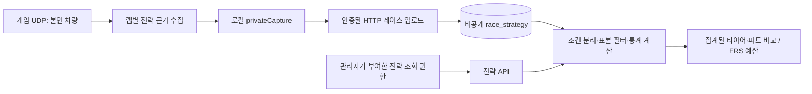

# 전략 실험실

`pithub.strategy.read` 조회 권한이 있는 사용자에게 `STRATEGY` 메뉴가 나타난다. 개인별 활성화 토글은 없다. 일반 `user` 역할에는 전략 권한을 기본 부여하지 않으며, 관리자가 기존 ACCESS 화면에서 역할에 조회 권한을 추가하고 대상 사용자에게 그 역할을 배정한다. 기존 상위 권한(`pithub.strategy`, `pithub`)도 동일한 권한 상속 규칙을 따른다.

신버전 Sender는 별도 전략 설정 없이 데이터를 수집하고, 페어링된 계정의 기존 레이스 업로드 경로로 자동 전송을 시도한다. 전략 조회 권한은 수집·업로드의 조건이 아니다. 화면을 열거나 로그인하는 것만으로 전략을 계산하지 않으며, 비교 버튼을 눌러 실행한다.

모든 사용자의 레이스 업로드에서 조건이 맞는 기록을 모아 타이어·피트 조합을 비교한다. AI API, 모델 다운로드, 과금·크레딧 소비는 없다. ERS는 실제 측정된 에너지 예산을 제공한다. 이 기능은 실험 단계이며 실제 경기 예측 정확도를 보장하지 않는다.

## 데이터 흐름



`privateCapture.strategy`는 기존 외부 직렬화 경계에서 함께 제거한다. WebRTC와 로컬 아카이브 API에 원본 근거를 추가하지 않는다. 다른 사용자에게 계정·세션·레이스 ID, 셋업, 랩별 연료·ERS 원본을 반환하지 않는다.

## API

모든 경로는 `Authorization: Bearer <web-session>`이 필요하고 `Cache-Control: no-store`를 반환한다. 업로드 토큰, 정지 계정, View As 세션은 사용할 수 없다. 조회와 계산 모두 `pithub.strategy.read`를 검사하며, 권한 없는 요청은 근거 조회 전에 차단한다.

| 경로 | 권한 | 동작 |
| --- | --- | --- |
| `GET /strategies/contexts?trackId=10&gameFormat=F1+26` | `pithub.strategy.read` | 선택 트랙·게임의 비교 조건 (`trackId` 생략 시 전체 트랙) |
| `POST /strategies/simulate?trackId=10&gameFormat=F1+26` | `pithub.strategy.read` | 선택한 조건과 재고에 따른 비교 |

개인별 설정 API와 `strategy_preferences` 테이블은 사용하지 않는다. 권한은 서버의 매 요청 인증에서 다시 확인하므로 회수 후 다음 조회·계산 요청은 `403`이다. Hub는 전략 화면 진입과 창 포커스 시 `/me`로 권한을 갱신한다. 권한 회수나 API의 `403` 응답을 확인하면 전략 화면을 내리고 기존 결과와 진행 중 요청을 정리한다. 이미 시작된 계정·트랙·권한 조회의 지연 응답이 새 계정이나 회수된 화면을 복원하지 않도록 세대와 토큰을 확인한다. 유휴 화면에서 권한 변경을 실시간으로 푸시하지는 않는다.

조건 조회 응답은 `contexts`, `records`, `truncated`, `recordLimit`, `minUsers`, `minSessions`, `minCleanLaps`, `diagnostics`, `archiveCoverage`를 가진다. `contexts`에는 조건 ID, `trackId`, 게임/차량/물리 설정, 날씨, 트랙 온도 구간, 보조 기능, 사용자·독립 경기·정상 랩 수만 포함된다. 조건 ID는 해당 응답에서 선택한다.

`diagnostics`는 조건 목록과 같은 중복 제거·조회 제한을 적용한 전략 근거의 수집 현황이다. 계정·세션 ID나 개별 측정값을 포함하지 않는다.

| 필드 | 의미 |
| --- | --- |
| `collectedLaps` | 전략 근거에 들어 있는 완료 랩 수 |
| `cleanLaps` | 정상 랩 판정과 알려진 경기 조건을 모두 만족해 조건 목록에 기여한 랩 수. 최종 회귀 표본과는 다름 |
| `excludedLaps` | 조건 목록에 기여하지 못한 서로 다른 랩 수. `collectedLaps = cleanLaps + excludedLaps` |
| `excludedRecords` | 조건 목록에 기여한 랩이 하나도 없는 전략 기록 수 |
| `exclusions[]` | `{code, records, laps}`. 같은 랩에 여러 사유가 있으면 각 사유에 한 번씩 집계하므로 사유별 합은 제외 랩 수보다 클 수 있음 |

`exclusions.code`에는 기존 제외 플래그와 `missing-conditions`, `unsupported-formula`, `missing-setup`, `missing-fuel`, `unknown-tyre`, `compound-change`, `no-completed-laps`가 들어간다. 레이스 전체의 `flashback`·`conditions-change`는 해당 기록의 모든 남은 랩에 적용된다. 되감기로 완료 랩이 지워진 경우에도 사유의 `records`는 1이고 `laps`는 0일 수 있다. 사유는 랩 수, 기록 수 내림차순 및 코드 오름차순으로 정렬한다. 빈 목록은 `[]`이다.

`archiveCoverage`는 같은 트랙·게임의 최근 정상 레이스 **업로드 행**을 전략 계측 유무와 관계없이 최대 `limit`(300)개 조회한 현황이다. `uploadedRaces`, `withEvidence`, `withoutEvidence`, `latestUploadAt`(RFC3339 또는 `null`), `truncated`, `limit`를 반환한다. `uploadedRaces = withEvidence + withoutEvidence`이며 `Race`/`Race 2`/`Race 3`만 포함하고 정지 계정·비정상 레이스는 제외한다. 전략 근거의 사용자당 20경기·세션 중복 제거 제한과는 다른 집계다. 서로 다른 파일명으로 올린 같은 경기는 여러 업로드 행으로 집계될 수 있다. 평생 업로드 수나 독립 경기 수로 표시하지 않는다.

따라서 `records=0`만으로 업로드 자체가 없다고 판단하지 않는다. `archiveCoverage.withoutEvidence`가 양수이면 일반 레이스 기록은 있으나 전략 계측이 첨부되지 않은 업로드가 있다는 뜻이다. 구버전 Sender, 선택적 업로드 크기 제한, 측정 누락 중 어느 것이 원인인지는 이 집계만으로 확정할 수 없다. 클라이언트는 배포 전환 중 추가 필드가 없으면 진단을 숨기고 기존 응답을 표시할 수 있다. 비교 기준 `minCleanLaps`는 40이며 조건 카드 표시 기준을 바꾸지 않는다.

비교 요청 예시:

```json
{
  "contextId": "조건 조회에서 받은 32자리 ID",
  "maxStops": 2,
  "availableSets": {"Soft": 1, "Medium": 1, "Hard": 1},
  "requireTwoCompounds": true
}
```

- `maxStops`: 0–2. `availableSets`: `Soft`, `Medium`, `Hard`, `Inter`, `Wet` 중 각 0–3개의 **새 타이어**. 전체 수량은 1개 이상.
- `requireTwoCompounds`: 서로 다른 타이어 종류 2개 이상 사용 여부. 경기 규정에 맞춰 사용자가 지정한다.
- 쿼리는 `trackId`(0–255), `gameFormat`(`F1 25`/`F1 26`)를 각각 한 번 요구한다. 중복·추가 쿼리, 누락된 필수 본문, 추가 본문 필드, 후행 JSON을 거부한다. 계산 본문 상한은 4 KiB다.
- 잘못된 입력 400, 미인증 401, 권한/세션 제한 403, 사라진 조건 404, 저장소 오류 500.

비교 응답의 주요 항목:

| 항목 | 의미 |
| --- | --- |
| `status` | `ready`, `insufficient-data`, `unidentifiable`, `no-feasible-plan` |
| `context` | 최종 회귀에 남은 사용자·독립 경기·정상 랩 수. 탐색 목록의 수보다 줄어들 수 있음 |
| `reasons` | 표본 부족, 연료/타이어 영향 분리 불가, 피트 자료 부족 등 |
| `compounds` | 실제 컴파운드별 상대 오프셋, 사용 1랩당 변화, 관측 타이어 나이 범위, 표본 수 |
| `fuelSlopeMsPerKg` | 회귀에서 추정한 연료 1 kg당 랩 시간 변화. 식별 불가 시 null |
| `lapMedianAbsoluteErrorMs` | 학습에 사용한 랩의 절대 오차 중앙값. 별도 경기 예측 오차가 아님 |
| `pit` | 피트 전후 랩의 관측 추가 시간과 편차·표본 수. 자료 부족 시 null |
| `plans` | 순서별 가장 낮은 비용의 조합 최대 8개. 스틴트 구간, 피트 랩, 첫 조합과의 차이 |
| `ers` | 실측 랩의 에너지 예산과 거리 3등분 구간별 값. 독립적인 표본 상태 포함 |
| `validation` | 현재 항상 `in-sample-only` |

`relativeCostMs`는 공통 기준 페이스·연료 항을 제외한 비교 비용이다. 절대 완주 시간이 아니다. `pitLaps`의 숫자는 그 랩을 **마친 뒤** 피트한다는 뜻이다. ERS 값은 J, 시간은 ms이며 화면에서 MJ·초로 변환한다.

## 근거 수집과 저장

기존 `POST /races`에 선택적인 `strategy` v1 필드를 추가했다. 레이스 업로드 권한·검증·트랜잭션을 그대로 사용한다. 전략 조회 권한과 로컬 저장 모드에 무관하게, 기능을 지원하는 Sender로 업로드한 레이스는 공통 근거가 된다. 기존 클라이언트의 전략 없는 업로드도 수용한다.

로컬 캡처의 스냅샷과 업로드 준비 단계에서는 검증 범위를 벗어난 개별 랩·피트 타이머만 제외해 다른 정상 완료 측정을 보존한다. 시간을 수정하거나 누락된 값을 채우지 않으며, 세션 조건 오류·모호한 랩 순서는 전체 제외하고 `flashback`·`conditions-change` 등 기존 제외 사유를 유지한다. 서버의 업로드 검증은 여전히 엄격하다. 위 수집 집계는 실제 첨부된 근거를 대상으로 하므로 로컬에서 버린 잘못된 측정 수는 포함하지 않는다.

수집 항목은 게임 연도/버전/포맷, 차량 규정, 경기 길이, 실제 이퀄 설정과 물리·보조 옵션, 본인 팀, 랩별 실제 컴파운드·시작 나이·연료·셋업 변경 이력·오염 사유, 피트 진입/이탈 랩, 실제 ERS 카운터다. 처음 상태를 받은 시점의 값을 사용하며 이전 랩 상태를 새 랩의 타이어 나이로 복제하지 않는다.

새 상태 패킷이 LapData보다 먼저 오면 해당 시각의 랩을 확인할 때까지 보류한다. 다음 랩에서 초기화된 ERS 카운터를 이전 랩에 합치지 않는다. 오래된 상태, 패킷 단절, flashback, 누락된 필수 측정은 적격 자료로 간주하지 않는다. 2026 차량의 Manual Override 랩도 기준 페이스에서 제외한다.

근거는 최대 200랩·30스톱·compact JSON 128 KiB다. 전체 HTTP 요청은 기존 480 KiB 안전 한도를 유지한다. 기존 랩·사고 업로드를 먼저 구성한 후 전략 근거가 들어갈 공간이 없으면 전략 근거를 생략한다. 플랫폼의 512 KiB 요청 한도와 WebRTC의 256 KiB SCTP/128 KiB 버퍼 기준은 변경하지 않았다. 기존 24대·TrackMap 최대 상태 크기 테스트와 privateCapture 제거 테스트로 외부 전송 경계를 확인한다.

마이그레이션 `016_strategy.sql`은 레이스별 비공개 `race_strategy`와 전략 조회 권한 카탈로그를 만든다. 일반 사용자 역할의 자동 권한 부여는 없다. 계정·레이스 삭제 시 함께 삭제한다. 플랫폼 시작 시 기존 마이그레이션 실행 경로로 적용된다. 신버전 플랫폼과 Sender가 필요하며, 과거 업로드의 누락된 연료·이퀄·타이어 나이는 소급 생성하지 않는다.

수집은 기존 정지 정책을 따르며 업로드에는 페어링 토큰과 `pithub.race.create`가 필요하다. 로컬 파일 저장을 꺼도 종료가 확정된 레이스의 자동 업로드를 시도한다. 다만 로컬 저장이 꺼져 있으면 네트워크 실패 후 재전송할 파일이 없고, 저장된 체크포인트의 업로드는 기존 재시도·종료 확인 정책을 따른다. 자동 수집은 모든 기록의 무손실 전달을 의미하지 않는다.

배포는 플랫폼 마이그레이션·API·웹 반영 후 신버전 Sender를 배포하는 순서다. 구버전 설치본에는 새 수집기가 없으므로 Sender 업데이트가 필요하다. 이미 적용된 마이그레이션은 체크섬 검증 대상이므로 수정하지 않고 후속 마이그레이션을 사용한다. 이번 `016` 정리는 미배포 변경에 한정하며 검증에는 새 격리 DB를 사용했다.

## 계산 방법과 한계

1. 트랙·게임별 최근 최대 300개 자료를 읽는다. 사용자당 최대 20경기, `(account_id, sessionUID)`당 가장 많은 랩이 있는 업로드 한 건을 선택한다. 정지 계정·비정상 레이스를 제외한다. 모든 사용자가 대상이지만 전체 과거 데이터를 무제한 조회하지 않는다.
2. 게임 포맷/연도/버전, 차량 규정, 세션 종류/길이, 경기 총 랩·트랙 길이, 이퀄 여부, 논이퀄의 팀, 게임 모드/규칙, 노면/연료/타이어/피트 물리·보조 설정, 날씨, 5°C 트랙 온도 구간, TC/ABS를 분리한다. 모르는 설정을 `false`나 `0`으로 추정하지 않는다.
3. 사고·손상·트래픽·DRS/Manual Override·SC/VSC·피트·무효 랩·시작 랩·페널티·자료 단절 등은 정상 페이스 회귀에서 제외한다. 비교 구간의 고정 셋업이 바뀐 자료도 제외한다. 새 프로세스로 재시작해 합친 셋업 이력을 같다고 추정하지 않는다.
   - 게임의 정수 타이어 손상 값에는 정상 마모가 포함된다. 측정 마모의 정수 올림 범위까지는 정상 마모로 취급하며, 그 범위를 넘는 손상·100% 손상·비정상 마모 값은 제외한다. 차체·엔진 손상과 DRS/ERS 고장 제외는 유지한다.
   - 완료 랩이 없고 직전·현재 모두 1랩의 현재/직전 랩 시간이 0인 출발 전 시계 초기화는 추정 플래시백으로 처리하지 않는다. 실제 주행 중 되감기와 명시적 `FLBK` 이벤트는 계속 제외한다.
   - LapData는 직전에 처리한 LapData보다 `OverallFrameIdentifier`가 오래된 패킷을 무시한다. UDP 순서 지연으로 이전 랩이 늦게 도착해도 완료 자료를 삭제하지 않는다. 실제 플래시백에서는 이 프레임 번호가 계속 증가하므로 기존 되감기 제외가 유지된다. 다른 패킷 종류의 프레임 번호로 LapData를 차단하지 않는다.
   - F1 2026 차량은 UDP 형식도 2026으로 수집해야 Manual Override 상태를 확인할 수 있다. 2025 형식에서 누락된 상태를 꺼짐으로 추정하지 않는다.
4. 최종 사용 자료는 최소 3명·6개의 서로 다른 sessionUID·40 정상 랩이 필요하다. 경기별 최소 4랩, 컴파운드별 최소 3명·6경기·나이 범위 3랩 이상이 필요하다. 자료 제외 후 이 기준과 관측 나이 범위를 다시 계산한다. 한 멀티플레이 경기를 여러 명이 업로드해도 독립 경기 수는 하나다.
5. `lapMs = 경기별 기준 페이스 + 연료량 효과 + 컴파운드 오프셋 + 해당 컴파운드 사용 나이 효과`를 가중 최소제곱으로 계산한다. 경기 내 중심화를 통해 드라이버/고정 셋업의 기준 페이스를 분리한다. 연료와 타이어 나이가 분리되지 않거나 회귀가 불안정하면 순위를 제공하지 않는다. 서로 다른 실제 컴파운드가 같은 타이어 색상으로 섞이면 비교를 보류한다.
6. 피트 추가 시간은 정상 피트의 진입·이탈 랩에서 예측 기준 페이스를 뺀 잔차다. 3.5초 이하의 정차가 있는 관측을 사용한다. 피트 레인 체류 시간이 아니며, 접근·이탈·타이어 예열을 포함한다. 정상 자료 3명·3경기 미만이면 피트 조합은 비교하지 않는다.
7. 새 타이어 세트와 최대 피트 횟수 안에서 최소 3랩의 스틴트를 조합한다. 첫 0–2랩의 예열을 근사하고 관측된 최대 타이어 나이 너머로 스틴트를 늘리지 않는다. 연료/트래픽/날씨를 바꿔 가며 완주 시간을 생성하지 않는다.
8. 피트·ERS는 업로더의 한 경기 안에서 먼저 중앙값을 구한 뒤 `1 / (사용자의 유효 경기 수 × 해당 경기의 유효 업로더 수)`로 가중 집계한다. 회귀도 같은 기여 제한을 랩 수에 분배한다. 같은 경기의 다수 업로더나 한 사람의 많은 업로드가 집계를 독점하지 않도록 한다.
9. ERS는 랩의 98% 이상을 측정한 실제 카운터 변화량만 사용한다. 배포·회수의 랩별 합계와 차이를 **먼저** 계산한다. 구간 중앙값을 합쳐 순사용량을 만들지 않는다. 거리 3등분은 공식 섹터와 다르며, 측정 구간을 가로지르는 표본은 거리 비율로 배분한다. 구간별 사용량은 그 구간의 시간 이득이나 최적 배포 위치를 증명하지 않는다.

위 최소 표본 수, 신선도·트래픽 기준, 온도 구간, 선형 근사, 새 타이어 초기 랩 근사는 초기 기준이다. 사고/SC 발생 확률, 날씨 전환, 실제 교통 속 복귀 위치, 개인 셋업과 타이어 열화의 상호작용은 예측하지 않는다. `ready`는 계산 가능한 근거가 있다는 뜻이며, 검증된 실제 최적 전략이라는 뜻이 아니다.

프로토콜 값은 프로젝트의 `docs/F1 25 Telemetry Output Structures.txt`와 [EA 공식 UDP 명세](https://forums.ea.com/blog/f1-games-game-info-hub-en/ea-sports%E2%84%A2-f1%C2%AE25-2026-season-pack-udp-specification/12187347)를 기준으로 한다. 피트 레인 타이어 시뮬레이션은 다른 보조 옵션과 달리 `0=켜짐, 1=꺼짐`이다. 게임 모드·규칙 이름은 [F1 25 명세의 부록](https://forums.ea.com/t5/s/tghpe58374/attachments/tghpe58374/f1-games-game-info-hub-en/61/4/Data%20Output%20from%20F1%2025%20v3.pdf)에 따라 표시하고 아직 이름을 모르는 값은 ID를 그대로 구분한다.

### 전체 트랙 탐색

Strategy 트랙 필터는 전체 트랙으로 시작한다. `GET /strategies/contexts?gameFormat=F1+26`처럼 `trackId`를 생략하면 선택한 게임의 모든 트랙을 조회한다. 조회 범위 전체의 최근 최대 300개·사용자별 최대 20경기 제한은 유지한다. 명시한 음수·빈 트랙 값과 중복 쿼리는 거부한다.

트랙 ID는 저장된 레이스에서 가져오며, 중복 제거와 조건 ID 생성에 포함한다. 동일 사용자·세션 UID·경기 설정이어도 트랙이 다르면 별도로 집계한다. 카드는 트랙명을 표시하고 검색할 수 있다. 전략 계산 POST에는 선택한 카드의 `trackId`가 반드시 필요하다.

화면은 조회 범위의 수집 기록(`records`)과 비교 가능한 경기 조건(`contexts`) 개수를 따로 표시한다. 클라이언트 검색·필터는 수집 기록 수를 바꾸지 않는다. 수집 기록이 0건인 상태와 기록은 있지만 정상 랩/알려진 조건이 없어 모두 제외된 상태를 구분한다. 최소 사용자·경기·정상 랩 수는 이후 전략 계산의 기준이며, 조건 카드 표시의 기준이 아니다. 이전 Sender가 저장한 일반 제외 플래그를 소급 해제하지 않으므로 수집기 수정은 새로 수집한 경기부터 반영된다.

수집 현황은 `archiveCoverage`의 최근 레이스 업로드·전략 계측 포함/없음과 `diagnostics`의 완료·정상·제외 랩을 구분해 표시한다. 정상 조건이 없으면 제외 사유를 펼쳐 보여주며, 같은 랩의 사유별 중복과 완료 랩이 없는 기록의 0랩 표기를 설명한다. 업로드 자체가 없는 경우와 일반 업로드에 전략 계측이 없는 경우의 안내도 구분한다. 순차 배포를 위해 두 진단 필드는 생략/null을 허용하며, 이때 해당 집계를 0으로 만들지 않고 숨긴다.

선택 조건의 참여자·독립 경기·정상 랩 수를 서버의 `minUsers`·`minSessions`·`minCleanLaps`와 함께 표시한다. 구버전 서버에 `minCleanLaps`가 없으면 기존 40랩 기준을 사용한다. 진행도 충족은 컴파운드별 표본·사용 범위나 회귀 식별 가능성을 보장하지 않는다. 새로고침은 검색과 필터, 여전히 존재하는 선택 조건을 유지하고 이전 전략 비교 결과를 지운다. 이후 늦게 도착한 이전 응답은 화면을 복원하지 않는다.
