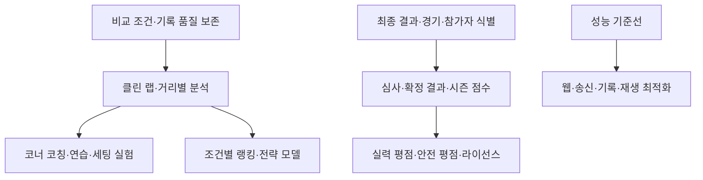

# frc.engineer 기능·성능 개선 기회 조사

2026-09-08 · 소스 `c7595e5378bbfc0cd51701d83e9fc3cb446ca849` · Driver Pack `4.54.0`

**공식 도구·서비스 20곳과 현재 구현을 대조해 기능 122개, 성능 28개, 총 150개의 개선 후보를 정리했다.** 가장 먼저 해결할 부분은 랭킹에서 “같은 조건의 기록을 비교하는가”와 “검증됐다는 말이 정확한가”이다. 그다음에는 거리별 시간차·코너 분석을 코칭과 세팅 실험으로 연결하고, 장시간 기록·재생 및 초기 로딩의 비용을 줄이는 순서가 적합하다. 이 우선순위와 기대효과는 **[Assumption]**이며 실제 사용자 규모·운영 지표에 따라 조정해야 한다.

[추가 확인: Pithub 배포 오류](#deployment) · [검색·필터가 가능한 전체 목록](20260908-improvement-opportunities.html) · [스프레드시트용 CSV](20260908-improvement-opportunities.csv) · [실측·출처 메타데이터](20260908-improvement-opportunities-evidence.json)

이번 결과는 구현할 후보와 판단 근거다. 조사 범위는 소스·공식 공개 자료·제한된 로컬 측정이며, 운영 서비스의 성능이나 외부 제품의 효과를 직접 사용해 비교한 실험은 아니다.

## 현재 기반과 기회

| 영역 | 이미 구현된 내용 | 다음 개선의 중심 |
|---|---|---|
| 실시간 경기 | Pitwall·Qualifying·Broadcast, 2025/2026 형식, 20/22/24대 예선 처리, 타이어·날씨·피트·ERS·배틀 정보 | 값의 출처·불확실성, 시나리오 비교, 역할별 화면 |
| Driver Pack 분석 | 자기 세션 간 랩 비교, 속도·페달·균형 trace, 조건 mismatch 안내, 세팅 snapshot·피드백 | 거리별 Δt, 코너별 손실, 채널 확대, 반복 연습 |
| 아카이브 | 경기 저장, 재생/일시정지/탐색/속도 조절, 전송 스트림·취소 | 초기 구간 즉시 재생, 장시간 메모리 제한, 구간 검색 |
| Hub | TT/Pace 보드, 프로필의 절대 순위·모집단, MySetups, 유료 마켓·후기·지갑, 경기/사건 분석 | 비교 조건·기록 신뢰도, 리그 운영과 결과 확정 |
| 협업·운영 | 인터컴, 오버레이 preset·hotkey, RBAC·ViewAs, telemetry 공개 범위, 업로드 재시도 | 짧은 지시·공동 분석·준비 상태·사용자 중심 진단 |
| 전송·렌더링 | MessagePack, view별 인코딩 cache, fast unreliable 위치 채널, reliable 응답, rAF 묶음 처리·선택적 store 구독 | 필요 데이터만 계산/전송, peer별 혼잡 대응, 측정 기반 최적화 |

근거: [K01](#K01)·[K02](#K02)·[K07](#K07)·[K10](#K10)·[K11](#K11)·[K12](#K12)·[K13](#K13)·[K15](#K15)·[K19](#K19)·[K20](#K20)·[K24](#K24).

기존 [기능 범위 로드맵](/workspace/frc.engineer/docs/feature-scope-roadmap.md)과 [2026-09-06 수정 상태](/workspace/frc.engineer/docs/reviews/20260906-remediation-status.md)를 함께 확인했다. 예선 인원수·리플레이 취소·프라이버시·대량 payload·마켓/분석 관련 과거 문제를 현재 미구현 기능으로 다시 세지 않았다. 예를 들어 “리플레이 스트리밍 추가”, “MessagePack 도입”, “구매 후기 추가”는 독립 신규 과제가 아니다.

## 우선 판단을 바꾸는 코드 근거

| 현재 확인한 사실 | 사용자에게 미치는 영향과 제안 | 근거 |
|---|---|---|
| TT SQL은 트랙·게임 형식·유효 랩·plausible·ban을 보지만 `session_type`으로 제한하지 않는다. | Race/Practice의 최고 랩도 TT에 섞일 수 있다. TT 전용과 전체 세션 PB의 의미를 먼저 나눈다. | [K04](#K04), [R02](#R02) |
| Pace는 최소 5개의 유효 랩 평균이며, 현재 정책은 피트 입출구 랩을 별도 제외하지 않는다. | 장거리 주행·피트 랩의 비율이 순위에 영향을 준다. 클린 랩 분모와 제외 이유를 저장하고 공개한다. | [K04](#K04)·[K05](#K05), [R01](#R01) |
| 업로드에는 세션 종류가 있지만 랩 단위 assist·연료·타이어 나이·SC/피트 상태가 충분히 보존되지 않는다. | 화면 필터만 추가해 공정성을 만들 수 없다. 파서→랩 요약→업로드→집계 계약이 필요하다. 오래된 기록은 unknown으로 유지한다. | [K05](#K05)·[K06](#K06), [R03](#R03)·[R04](#R04) |
| plausible는 제출 형식·수치 범위의 일관성 검사이며, 클라이언트 데이터의 진위를 보증하지 않는다. | “검증 세션” 등의 표현을 실제 확인 수준에 맞춘다. 이후 교차 확인·심사 증거를 단계적으로 추가한다. | [K05](#K05)·[K13](#K13), [R15](#R15)·[R16](#R16) |
| 랭킹 보드는 200행 제한이지만 프로필 SQL은 전체 모집단 순위와 인원수를 계산한다. | 이미 있는 절대 순위를 Rankings에도 연결하고 내 주변 행·다음 페이지를 제공한다. 증분 집계 구축이 첫 단계의 필수 조건은 아니다. | [K04](#K04)·[K21](#K21), [R09](#R09) |
| FinalClassification·TimeTrial은 parser switch에서 처리되지 않고, 종료 위치는 마지막 live 상태에 의존한다. | 최종 시간 벌점·DNF를 반영한 결과와 참가자 식별부터 확보해야 리그 점수·실력 평점의 근거가 생긴다. Advanced raw 기록을 활용할 가능성은 별도 검증한다. | [K05](#K05)·[K06](#K06), [L01](#L01)·[R17](#R17) |
| 현재 비교 trace는 50m 평균 구간·최대 200포인트를 사용한다. | 짧은 제동 해제 동작을 보기 어렵고 시간 손실의 시작점을 읽기 제한적이다. 구간 확대·거리별 Δt·동기 커서가 우선 확장이다. | [K01](#K01)·[K02](#K02), [A01](#A01)~[A04](#A04) |
| Lockup은 `brake > 0.9`와 `speed > 80` 조건을 사용하는 휴리스틱이다. | 휠 잠김과 강한 제동을 구분하도록 표시·판별을 개선한다. MotionEx는 플레이어 전용이며 현재 JSONL은 rawHex라 오프라인 디코딩/저장 확장이 필요하다. | [K03](#K03), [A13](#A13) |
| 타이어 예측에는 선형 마모/나이 모델, 크로스오버에는 slick과 wet 그룹의 관측 평균을 쓰는 경로가 있다. | 단일 숫자의 신뢰도를 높이려면 조건·표본·예측 오차를 함께 다뤄야 한다. 상대 데이터의 공개 범위와 실력 편향을 고려한다. | [K07](#K07), [C02](#C02)·[C07](#C07)·[C08](#C08) |
| Sender의 “skip dashboard telemetry” 주석과 달리 `NewProcessor(..., 0)`은 0 간격을 설정하고 dashboard 계산·방송 경로를 허용한다. | 현재 웹 메시지 처리 경로와 실제 legacy 소비자를 조사해 불필요한 계산·송신을 줄일 수 있다. 실제 빈도와 절감량은 아직 측정하지 않았다. | [K14](#K14)·[K20](#K20), [P04](#P04) |
| 느린 peer의 drop 비율이 전역 Pitwall 빈도를 4Hz↔2Hz로 바꾼다. | 한 연결의 혼잡이 정상 연결에도 영향을 줄 가능성이 있다. peer별 분리의 효과를 혼합 네트워크 조건에서 측정한다. | [K14](#K14)·[K15](#K15), [P06](#P06) |
| 500ms마다 replay 상태가 누적되고, 클라이언트는 스트림 전체 수신 후 재생한다. | 긴 경기의 메모리·첫 재생 대기 시간을 줄일 구체적 개선점이다. 서버 스트리밍과 취소 기능은 이미 있다. | [K14](#K14)·[K17](#K17)·[K19](#K19), [P11](#P11)·[P12](#P12) |
| Parser가 raw+JSON 로거를 동기 호출하고, 분석 cache는 크기가 제한되지 않은 map이다. | 디스크 지연 전파·중복 분석·장시간 메모리 증가를 부하 실험에서 우선 관측한다. | [K16](#K16)·[K18](#K18), [P15](#P15)·[P19](#P19)·[P20](#P20) |

## 직접 측정한 결과

| 측정 | 결과 | 해석 범위 |
|---|---|---|
| 기존 `TestBuildState24CarPayloadSize` 재실행 | **PASS**. 24대+2,000점 트랙맵 **91,674B**, 정상 상태 **35,598B** | history·penalty 상한 등을 채운 기존 fixture의 MessagePack envelope다. 실게임 전송률·최대 브라우저 지연 측정은 아니다. |
| 웹 Vite production build | **PASS**, 232 modules, 1.82초. JS **902,360B**, Vite 표시 gzip **216.49kB**. CSS **48,399B**, gzip **10.38kB** | 한 JS chunk로 생성됐고 크기 경고가 있었다. 실제 초기 로딩 시간·메인 thread 부하·전체 TypeScript 검증은 이번 명령의 측정 범위 밖이다. |

재현 명령과 결과 요약은 [evidence JSON](20260908-improvement-opportunities-evidence.json)에 기록했다. 실행 환경은 Linux amd64, Go 1.26.7, Node 24.11.0이다. 테스트의 임시 track store 초기화 경고 뒤에 주입한 트랙맵 검증은 통과했다. 빌드 산출물은 저장소 밖 임시 디렉터리에 만들었다.

**페이로드 해석.** 저장소의 2026 형식은 **24대**를 기준으로 해야 한다. 이번 fixture는 프로젝트의 단일 메시지 256KiB 보호값 아래이고 정상 상태도 128KiB 기준 아래다. 그러나 `maxBufferedAmount=128KiB`는 연결의 누적 대기량이므로 단일 메시지가 작다는 사실만으로 혼잡이 해결되지는 않는다. 실제 협상된 `maxMessageSize`, 송신 큐, 맵 포함 burst와 다른 채널을 함께 측정해야 한다. 256KiB를 모든 브라우저·연결의 보편적인 고정 규격이라고 일반화하지 않는다. [K15](#K15)·[K22](#K22)·[WebRTC 표준](https://www.w3.org/TR/webrtc/)

**[Assumption] 규모 계산 예시.** 35,598B 상태가 계속 4Hz로 나간다고 가정하면 peer 1명당 약 **1.14Mbit/s**, 4명은 **4.56Mbit/s**, 16명은 **18.23Mbit/s**다. 위치·legacy dashboard·음성·헤더·맵 burst·TURN 효과는 제외한 계산이다. 실제 트래픽으로 보고한 수치가 아니다. replay가 2Hz이면 시간당 7,200개 상태가 쌓이지만 네트워크 직렬화 크기를 그대로 Go/브라우저 heap 크기로 환산할 수는 없다.

## 먼저 구체화할 12개 작업 묶음

아래는 150개를 전부 구현하기 위한 일정이 아니라, 다음 의사결정에 사용할 **[Assumption] 우선 순서**다. 관련 데이터 기반을 한 번 만들고 여러 기능이 쓰도록 묶었다. 날짜·매출·정량 개선율은 추정하지 않았다.

| 순서 | 작업 묶음 | 대상 | 완료 판단 |
|---|---|---|---|
| 1 | 의미가 정확한 랭킹 | R02·R15·R08·R09 | TT/PB 출처·실제 확인 수준·초 단위 편차·내 주변 기록을 사용자가 설명할 수 있음 |
| 2 | 성능·품질 기준선 | P01·A18·U03 | 처리 지연·drop·신선도·CPU·heap을 같은 fixture와 환경에서 다시 측정 가능 |
| 3 | 공정한 비교 데이터 | A11·R01·R03·R04·R05 | 랩별 비교 조건과 제외 이유 보존, 과거 unknown 기록의 별도 취급 |
| 4 | 공식 결과와 경기 식별 | L01·R17 | live 순위와 최종 결과 구별, 여러 송신자가 같은 경기를 제출해도 검토 가능 |
| 5 | 체감 가능한 랩 분석 | A01·A02·A04·A06 | 거리별 Δt·확대·커서·채널 비교로 시간 손실 위치를 확인 |
| 6 | 분석에서 다음 연습으로 | A03·A13·B01·B04 | 신뢰 가능한 신호로 다음 행동을 제시하고 재주행으로 결과를 확인 |
| 7 | 전략의 비용과 오차 | C01·C02·C05·C07·C13 | 정차 시나리오·피트 복귀·연료 범위를 비교하고 실제 오차를 기록 |
| 8 | 첫 진입과 작업 연결 | U01·U02·U04·U08 | 연결 문제와 기록 모드의 차이를 이해하고 현재 세션에서 분석으로 바로 이동 |
| 9 | 초기 웹 로딩 | P02·필요 시 P03 | 초기 자산과 사용자 대기 시간 감소, 화면 이동 시 직렬 로딩 악화 없음 |
| 10 | 장시간 기록·리플레이 | P11·P12·필요 시 P13 | 첫 구간 즉시 재생, 장시간 기록 보존, 메모리 증가율 억제 |
| 11 | 송신·기록·분석의 처리 비용 | P04·P06·P15·P18·P19·P20 | 정상 peer 빈도 보존, 디스크 지연 격리, 중복 작업·cache 메모리 제어 |
| 12 | 리그 운영의 최소 연결 | L07·L11·L12·L04 | 사건 접수→심사→결과 확정→시즌 점수 정정까지 일관되게 연결 |

실력 평점·안전 평점·라이선스(R12~R14), 다중 게임(U11), 내구 교대(C20), 대규모 관전자 중계(P28)는 결과 신뢰성·수요·운영 모델을 먼저 확인할 후속 투자다. 이미 확보된 F1 개인 분석과 원격 엔지니어 경험을 발전시키는 과제와 동일한 착수 시점으로 잡지 않는다.

## 참고한 도구·서비스 20곳

확인일은 **2026-09-08**이다. 공식 제품 설명·도움말·개발자 저장소를 사용했다. 아래의 “관찰한 기능”은 출처 요약이고, “프로젝트 적용”은 **[Assumption] 설계 제안**이다. 후보에 붙인 X 코드는 영감을 준 서비스이며, 그 서비스가 제안 전체를 그대로 구현했거나 F1의 모든 신호에 접근할 수 있다는 뜻은 아니다. 예고·Early Access·과거 버전 사례는 별도로 표시했다.

| 참조 | 서비스·공식 출처 | 관찰한 기능 | 프로젝트 적용 | 가용성·범위 |
|---|---|---|---|---|
| X01 | **Track Titan** · [RTO](https://www.tracktitan.io/rto) · [Telemetry analysis guide](https://www.tracktitan.io/post/how-to-analyse-telemetry-for-sim-racing) | 거리·코너별 비교와 RTO의 기준 페달 안내. | A01~A04·B01·B09: 어디서 시간을 잃는지에서 다음 입력 행동까지 연결. | F1 관련 공식 자료가 있다. RTO의 게임별 지원 범위는 별도 확인 대상. |
| X02 | **Popometer** · [공식 사용 가이드](https://popometer.io/p/popoguide) | Δt, 지도와 커서 동기화, 코너 확대, 기준 랩·팀 비교를 설명한다. | A04·A07·B07: 상세 분석의 기본 조작과 팀 비교 설계. | 다른 시뮬레이터의 분석 경험을 참고한다. F1 지원을 전제하지 않는다. |
| X03 | **VRS** · [Academy](https://vrs.racing/us/academy) · [Setups와 지원 예정 게임](https://vrs.racing/setups) · [Data packs FAQ](https://vrs.racing/faq) | telemetry·리플레이·영상·세팅을 묶은 데이터팩과 팀·코칭 흐름. | A07·B08·B11·S04: 기준 랩의 조건·설명·접근 권한을 하나로 연결. | 공식 setups 페이지의 F1·LMU는 Coming Soon 표기. 현재 사용 가능하다고 전제하지 않는다. |
| X04 | **Garage61** · [Filtering](https://garage61.net/docs/usage/filtering) · [Ghosts](https://garage61.net/docs/usage/ghosts) · [Pro](https://garage61.net/pro) | 클린/완주/피트 랩·세션·날씨·연료·세팅 조건 필터, ghost와 팀 공유. | A11·R03~R04·B02: 공정한 비교 조건과 따라갈 수 있는 기준 랩. | iRacing 중심 사례. ghost는 지원 게임의 오프라인 기능이며 Pro live timing은 Early Access로 구분한다. |
| X05 | **trophi.ai** · [공식 기능 소개](https://www.trophi.ai/sim-racing-expo) · [1.91.0 업데이트, 2026-04-01](https://www.trophi.ai/updates/1-91-0) | 음성 코칭·적응형 학습 경로, 그래프 근거를 보여주는 코칭 질의 기능을 안내한다. | B01·B03·B10: 한 번의 분석을 반복 연습과 연결. | F1 등을 공식 안내하지만 AI 성능 향상 수치는 이번에 검증하지 않았다. |
| X06 | **Sim Racing Telemetry** · [제품 기능](https://simracingtelemetry.com/) · [지원 도움말](https://www.simracingtelemetry.com/help.html) · [F1 25 연결](https://www.simracingtelemetry.com/games/F12025/) | 여러 채널·랩의 비교, 시간차·통계, CSV 내보내기와 여러 플랫폼 기록. | A06·A20·U01·U05: 수집·비교·내보내기를 일관된 흐름으로 제공. | 공식 도움말에 F1 26, F1 25 가이드에 PC·콘솔 UDP 연결이 안내된다. |
| X07 | **Telemetry Tool** · [공식 기능·게임 목록](https://telemetrytool.com/) | 실시간/오프라인 다중 랩, 주행 라인, 경기 이력, 전략·연료 절약 분석과 원격 엔지니어 기능. | A05·A09·C01·C03·C19: 현재 라이브 Pitwall과 경기 후 분석을 연결. | F1 2012~26을 포함한 지원 목록을 공식 페이지에서 확인했다. 게임마다 데이터는 다르다. |
| X08 | **Crew Chief** · [공식 저장소와 기능 설명](https://github.com/mrbelowski/CrewChiefV4) | 연료·타이어·피트 복귀 정보에 관한 질의, 주행 상황에 따른 음성 안내와 PTT. | C05·C13·C17~C18: 필요한 시점에 짧게 알려주는 엔지니어 경험. | 게임별 기능 차이가 크다. 타 게임의 피트 명령 자동 조작을 F1에 그대로 적용할 수 없다. |
| X09 | **SimHub** · [제품 소개](https://www.simhubdash.com/) · [공식 변경 기록](https://www.simhubdash.com/download-2/) | 사용자가 구성하는 대시보드, 장치·햅틱·커뮤니티 확장. | V01·U12: 출력 화면과 하드웨어 연결을 분리한 구성. | 공식 변경 기록에 2026-06-03 F1 25의 2026 형식 지원이 안내된다. |
| X10 | **RaceLab** · [F1 기능](https://racelab.app/formula1/) · [Stream Deck, 2026-02-23](https://garage.racelab.app/news/2026/02/23/2026/stream-deck-plugin/) | F1 기준 페달 비교·맵·사용자 데이터 블록, 상태가 동기화되는 Stream Deck 제어. | B09·V01·U12: 기준 랩을 운전 화면에 연결하고 표시 조작을 단순화. | F1 전용 공식 페이지를 확인했다. 모든 게임의 전체 위젯 지원을 의미하지 않는다. |
| X11 | **EA Racenet** · [F1 24 Racenet 공식 소개](https://www.ea.com/nl/games/f1/news/f1-24-racenet) | 3D Time Trial 비교·친구/전체 순위와 리그 일정·티어·규정·결과 흐름. | R02·R09·L02·L11: F1 사용자의 기록 비교와 대회 운영을 함께 설계. | 2024-06-27 F1 24 공식 소개에서 확인한 설계 사례다. 현재 2026 버전의 기능 동등성은 미확인. |
| X12 | **F1Laps** · [공식 기능 FAQ](https://www.f1laps.com/faqs/free-trial-whats-included/) · [F1 25](https://www.f1laps.com/f1-25/) · [F1 26](https://www.f1laps.com/f1-26/) | telemetry 비교·세션/커리어 이력·AI 난이도 계산을 제공한다. | B04·B12·R19: 개인 성장과 F1 연습 상대 설정을 연결. | F1 25와 F1 26 공식 안내 페이지가 있다. AI 추천 정확도는 실측하지 않았다. |
| X13 | **iRacing** · [iRating](https://support.iracing.com/support/solutions/articles/31000133523-what-is-irating) · [Safety Rating, 2026-07-15 수정](https://support.iracing.com/support/solutions/articles/31000156960-iracing-how-to-safety-rating) · [Championship points](https://support.iracing.com/support/solutions/articles/31000173795-championship-points) | 경기 상대 수준을 반영한 iRating과 주행 노출량·사건에 기반한 Safety Rating을 분리한다. 챔피언십에는 SOF·드롭·디비전 규칙이 있다. | R12~R14·L04·L06: 속도·안전·참여를 별도 지표와 제도로 설계. | iRacing 공식 경기 시스템의 사례다. 클라이언트 업로드만으로 같은 신뢰성을 얻을 수 없고 산식을 그대로 복제하지 않는다. |
| X14 | **Low Fuel Motorsport** · [Legacy 시즌 규칙](https://legacy.lowfuelmotorsport.com/seasonsv2/rules) · [Legacy 심사 규칙](https://legacy.lowfuelmotorsport.com/seasonsv2/penalties) · [Legacy hotlaps](https://legacy.lowfuelmotorsport.com/hotlaps) | ELO/SOF·시즌 규칙, 심사·제재 흐름, hotlap의 버전 필터와 증거 제출 사례. | R05·R16·R18·L07~L11: 기록과 심사 기준의 버전·출처를 관리. | 열람 가능한 공식 legacy 페이지를 참고했다. 현재 서비스의 벌점 수치·자격 기준이라고 주장하지 않는다. |
| X15 | **SimGrid** · [Community 기능](https://www.thesimgrid.com/communities/join) · [공동 운영, 2026-03-12](https://pits.thesimgrid.com/announcements/community-collabs-is-here/) | 커뮤니티 대회, 자동 순위·엔트리·팀/클래스 점수 설정, 공동 운영과 Discord 연계. | L02~L05·L07·L12: 경기 기록 위에 운영자의 반복 업무를 연결. | 대회 운영 모델의 참고 사례다. F1 결과 자동 수집 연동이 된다고 전제하지 않는다. |
| X16 | **Simracing.GP** · [공식 제품 안내](https://simracing.gp/?trk=public_post_main-feed-card-text) · [Championship vs Series](https://simracing.gp/tutorials/championship-vs-series/) · [Event page](https://simracing.gp/tutorials/event-page-guide/) | championship/series 구분, 사용자 점수 체계, 경기 페이지·참가·서버 운영과 수동 결과 모드. | L02·L03·L06·L16: 자동 연동이 없는 게임에서도 운영 흐름을 분리. | 공식 안내에서 게임별 자동/수동 범위가 다르며 F1 2024는 수동 결과 사례다. |
| X17 | **Racing League Tools** · [공식 기능](https://racingleaguetools.com/Features) · [고급 기능](https://racingleaguetools.com/AdvancedFeatures) | F1 UDP 결과 수집, 여러 시즌 순위·클라우드 협업·결과 그래픽과 pace/consistency 분석을 안내한다. | L01·L04·L14·R07: F1 리그의 결과 확정과 공유를 구체화. | pace 지표의 정확한 산식은 공개 페이지에서 확인되지 않아 수치·동일 알고리즘을 추정하지 않았다. |
| X18 | **Coach Dave Delta** · [Delta 기능](https://coachdaveacademy.com/delta/) · [Setup IQ, 2026-07-09](https://coachdaveacademy.com/announcements/setup-iq-tailor-made-setups/) | telemetry와 영상 연결, 코너 단계 분석, Setup IQ의 맞춤 세팅 흐름을 안내한다. | A03·B11·S03~S06: 세팅 변경의 관측 근거와 주행 효과를 연결. | Delta 6.0/2026 소개의 지원 게임 사례다. F1 지원이나 AI 개선 효과를 전제하지 않는다. |
| X19 | **Second Monitor** · [공식 릴리스](https://github.com/Winzarten/SecondMonitor/releases) | 공식 공개 릴리스에 서스펜션 히스토그램·G-G·차고 산점도 등 차량 동역학 분석 사례가 있다. | A13~A17: 이미 수집되는 물리 채널을 진단에 활용. | 공식 오픈소스 릴리스의 기능 사례이며 현재 F1 지원을 확인한 것은 아니다. |
| X20 | **iRacePlan** · [Stint Planner, 2025-03-19](https://iraceplan.com/blog/introducing-the-stint-planner-revolutionize-your-race-strategy-with-iraceplan-s-most-powerful-tool-yet) · [Stint Preferences, 2025-06-20](https://iraceplan.com/blog/introducing-stint-preferences-smarter-driver-assignment-for-endurance-racing) | 협업 스틴트 계획·Garage61 연결, 운전자 시간·야간/우천 선호를 고려한 배정. | C01·C19·V06: 계획과 실제 기록 연결. C20은 내구 레이스 게임 확장 시 적용. | 2025 공식 기능 소개에 근거한다. F1에는 드라이버 교대가 가능한 것으로 표시하면 안 된다. |

## 개선 후보 150개

**읽는 방법.** 확장 70개·신규 47개·교정 5개가 기능 후보 122개이고, 성능 후보는 28개다. 우선순위 1은 다음 계획에서 우선 검토할 47개이며 모두 동시에 착수한다는 뜻이 아니다. 2는 기반을 만든 뒤 확장할 87개, 3은 수요·외부 연동·운영 체계가 갖춰진 뒤 검토할 16개다. 상/중/하는 상대 난이도이며 모두 **[Assumption]**이다.

D1은 현재 받는 데이터로 시작할 수 있음을 뜻하지만 기록 모드·세션별 실제 보유 여부를 확인해야 한다. D2는 파싱·시간 정렬·저장 스키마·메타데이터 중 하나 이상의 확장이 필요하다. D3는 외부 SDK·콘텐츠·명시적 정책·사용자 설정이 필요하다. 미수집 값은 unknown으로 유지한다.

성능의 “실측후보”는 현재 자산 크기만 측정했다는 뜻이고, “정적후보”는 코드에서 찾은 검증할 가설이다. 개선율과 운영 병목은 입증되지 않았다. 검증 칸은 구현 후 확인할 기준이며 이미 통과한 테스트를 뜻하지 않는다.

### 주행 분석 — 20개

| ID · 상태 | 개선점과 사용자 효과 | 필요 데이터·선행 조건 | 우선/난이도 | 근거 | 구현 후 검증 |
|---|---|---|---|---|---|
| **A01** · 확장 | **거리별 누적 시간차** — 현재 랩·섹터 차이에 거리별 누적 Δt 곡선을 더해 실제로 시간을 잃기 시작한 위치를 찾는다. | D1: 원시 lap time·distance와 유효 랩 | 1 / 중 | [K01](#K01) · [K02](#K02) [X01](#X01) · [X02](#X02) · [X06](#X06) | 완주 시 곡선의 끝값이 공식 랩타임 차이와 일치 |
| **A02** · 확장 | **제동 구간의 분석 해상도** — 50m 평균 구간을 코너에서는 더 촘촘하게 제공하고 원시 샘플도 확대 조회해 짧은 브레이크 해제 동작을 보존한다. | D1: Advanced 원시 trace; A01 | 1 / 중 | [K01](#K01) [X02](#X02) · [X07](#X07) | 짧은 제동 펄스 보존 및 해상도별 용량·오차 비교 |
| **A03** · 확장 | **코너 단계별 손실 설명** — 진입·제동·최저속도·탈출·다음 직선으로 손실을 나눠 가장 큰 원인 후보와 연습할 코너를 제시한다. | D1: A01·A02, 코너 경계와 불확실성 | 1 / 상 | [K01](#K01) · [K25](#K25) [X01](#X01) · [X02](#X02) · [X18](#X18) | 수동 코너 라벨과 비교하고 다음 직선 손실까지 귀속 |
| **A04** · 확장 | **차트와 트랙맵의 동기 탐색** — 현재 정적 trace에 공통 커서·구간 확대·코너 이동을 붙여 지도와 모든 채널을 같은 거리에서 비교한다. | D1: 기존 trace·지도 | 1 / 중 | [K01](#K01) · [K02](#K02) [X02](#X02) · [X06](#X06) | 커서 이동 시 모든 채널·지도 거리 일치 |
| **A05** · 신규 | **주행 라인 겹쳐보기** — 두 랩의 좌표를 같은 트랙 기준으로 겹쳐 진입 폭·에이펙스·탈출 위치 차이를 보여준다. | D1: Motion 좌표; 게임·레이아웃 일치 | 2 / 상 | [K01](#K01) · [K03](#K03) · [K25](#K25) [X02](#X02) · [X03](#X03) · [X07](#X07) | 좌표 정렬 오차 표시, 다른 레이아웃 비교 차단 |
| **A06** · 확장 | **분석 채널 선택** — 현재 속도·페달·균형 trace에 조향·기어·RPM·ERS·연료 등 실제 수집 가능한 채널을 선택해서 비교한다. | D1/D2: 채널별 파싱·저장 여부 확인 | 1 / 중 | [K01](#K01) · [K03](#K03) · [K09](#K09) [X03](#X03) · [X06](#X06) · [X18](#X18) | 없는 채널을 0으로 만들지 않고 단위·시점 보존 |
| **A07** · 신규 | **동의받은 타인 기준 랩** — 기존 자기 세션 간 비교를 팀원·코치·공개 기록의 trace 비교로 확장한다. | D2/D3: trace 업로드·소유권·공유 범위 | 2 / 상 | [K01](#K01) · [K02](#K02) · [K24](#K24) [X02](#X02) · [X03](#X03) · [X04](#X04) | 권한별 접근 차단과 조건이 맞는 기준 랩 선택 |
| **A08** · 신규 | **대표 랩 자동 선택** — 우연히 빠른 한 랩 외에 스틴트 중앙값에 가까운 랩을 기준으로 골라 반복 가능한 페이스를 분석한다. | D1: A11의 비교 가능한 랩 집합 | 2 / 중 | [K01](#K01) · [K07](#K07) [X04](#X04) · [X07](#X07) | 이상치 한 랩을 넣어도 대표 랩이 급변하지 않음 |
| **A09** · 신규 | **여러 랩의 분산 밴드** — 동일 구간의 속도·제동 위치 분산을 겹쳐 일관성이 낮은 코너를 찾는다. | D1: 정렬된 다중 랩 trace | 2 / 중 | [K01](#K01) [X07](#X07) · [X19](#X19) | 선택 랩·유효 샘플 수와 구간별 분산 재계산 일치 |
| **A10** · 확장 | **이론 최고 랩과 실현 가능성** — 공식 유효 섹터 또는 비교 가능한 구간의 최솟값을 합산하되 가상 조합임을 명시한다. | D1: 섹터 유효성; 동일 조건 필터 | 2 / 중 | [K01](#K01) · [K08](#K08) [X04](#X04) · [X18](#X18) | 무효 섹터 제외, 합성 기록이 공식 PB로 등록되지 않음 |
| **A11** · 확장 | **클린 랩 분류** — 유효성에 더해 피트 입출구·SC/VSC·정체·웜업·손상 구간을 표시하고 분석 표본을 고르게 한다. | D2: 랩별 상태·제외 사유 저장 | 1 / 상 | [K05](#K05) · [K06](#K06) · [K07](#K07) [X04](#X04) | 제외 이유와 표본 수가 사용자에게 재현 가능 |
| **A12** · 신규 | **연료·타이어를 고려한 페이스** — 서로 다른 연료량·타이어 나이의 랩을 조건별로 묶고 충분한 표본에서만 보정 페이스를 실험한다. | D2: 랩별 연료·타이어·날씨; A11 | 2 / 상 | [K05](#K05) · [K07](#K07) [X04](#X04) · [X20](#X20) | 보정 전후와 별도 세션 예측 오차를 함께 표시 |
| **A13** · 교정 | **Lockup의 의미와 실제 휠 신호** — 강한 제동으로 계산되는 현재 Lockup을 추정값으로 표시하고 플레이어는 WheelSpeed·SlipRatio로 휠 잠김 판별을 보강한다. | D2: 플레이어 MotionEx 원시 디코딩 또는 typed 저장·분석, assist 조건 | 1 / 중 | [K03](#K03) [X19](#X19) | 고속 최대 제동이지만 휠이 굴러가는 사례를 잠김과 구분 |
| **A14** · 확장 | **언더·오버스티어 진단 보정** — 고정 slip·조향 임계값을 속도·앞바퀴 각도·yaw rate와 함께 검증하고 추정 신뢰도를 붙인다. | D2: MotionEx 원시 디코딩/저장·오프라인 분석·게임별 검증 기록 | 2 / 상 | [K03](#K03) [X18](#X18) · [X19](#X19) | 코치가 라벨한 구간의 오탐·미탐률과 속도별 편향 확인 |
| **A15** · 확장 | **코너별 타이어 열·압력 분석** — 현재 타이어 상태·예측을 타이어 내부/표면 온도·압력의 코너별 변화와 권장 범위 체류시간으로 확장한다. | D1/D2: 플레이어 타이어 trace 보존 | 2 / 중 | [K03](#K03) · [K07](#K07) [X18](#X18) | 스냅샷 최종값과 전체 스틴트 최고·평균을 구분 |
| **A16** · 신규 | **서스펜션·차고 분포** — 플레이어 MotionEx의 서스펜션 속도·차고를 히스토그램과 속도별 산점도로 보여준다. | D2: 수신된 MotionEx rawHex 디코딩 또는 typed 저장·오프라인 분석 | 3 / 중 | [K03](#K03) [X19](#X19) | 휠 순서·단위 검증, 미지원 채널 비표시 |
| **A17** · 신규 | **G-G·트랙션 사용 분석** — 횡·종가속과 페달을 함께 보여 제동과 회전의 전환을 분석한다. | D1: Motion·Telemetry 시간 정렬 | 2 / 중 | [K03](#K03) [X19](#X19) | 좌표계·부호 검증, 그래프를 절대 접지 한계로 오인하지 않음 |
| **A18** · 확장 | **기록 품질 타임라인** — 기존 보고서 completeness를 샘플 누락·지연·재시작·flashback 위치까지 확대해 분석 신뢰도를 설명한다. | D2: 패킷별 관측시각·sequence·손실 통계 | 1 / 중 | [K10](#K10) · [K16](#K16) [X04](#X04) | 의도한 유실 구간에서 gap 표기와 보간 제한 |
| **A19** · 확장 | **샘플 결합의 시간 정합성** — 현재 ±2 frame 결합에 시간차·출처를 남겨 다른 주기의 채널이나 누락 구간을 잘못 정렬하지 않게 한다. | D1/D2: frame·session time·시도 구분 | 2 / 상 | [K01](#K01) · [K06](#K06) [X06](#X06) | 20/60Hz·누락·되감기에서 채널별 최대 시차 측정 |
| **A20** · 신규 | **표준 trace 내보내기** — 선택한 랩·채널·단위를 CSV로 내보내고 결측·유효성·게임 버전을 함께 제공한다. | D1: 선택 범위·권한 확인 | 2 / 중 | [K01](#K01) · [K24](#K24) [X06](#X06) | 재가져오기 후 시각·거리·단위·결측 일치 |

### 코칭·성장 — 12개

| ID · 상태 | 개선점과 사용자 효과 | 필요 데이터·선행 조건 | 우선/난이도 | 근거 | 구현 후 검증 |
|---|---|---|---|---|---|
| **B01** · 신규 | **다음 주행의 개선 과제 3개** — 분석 결과에서 근거가 가장 명확한 동작만 골라 다음 주행에서 바꿀 행동과 예상 영향 구간을 제시한다. | D1/D2: A03·A18, 코칭 검증셋 | 1 / 상 | [K01](#K01) · [K02](#K02) [X01](#X01) · [X05](#X05) · [X18](#X18) | 추천 근거 구간 확인 및 실제 재주행 개선율 측정 |
| **B02** · 신규 | **조금 빠른 기준 랩 추천** — 최상위 기록만 제시하지 않고 조건과 실력이 가까운 기준 랩을 추천한다. | D2/D3: A07·R03, 동의된 reference pool | 2 / 중 | [K04](#K04) · [K05](#K05) [X01](#X01) · [X04](#X04) | 조건 일치율과 사용자가 끝까지 따라간 비교 비율 |
| **B03** · 신규 | **목표 기반 연습 계획** — 트랙·가능 시간·약한 기술을 입력받아 짧은 연습 단위를 구성하고 완료 결과를 기록한다. | D2: 연습 목표·완료 모델; B01 | 2 / 중 | [K02](#K02) · [K13](#K13) [X05](#X05) | 주간 수행률과 목표 기술의 재측정 변화 |
| **B04** · 확장 | **장기 성장 곡선** — 기존 DriverProfile 통계를 조건별 PB·중앙 페이스·편차·코너 손실 추이로 확장한다. | D2: 비교 가능한 기록·기간; R05 | 1 / 중 | [K21](#K21) · [K04](#K04) [X05](#X05) · [X12](#X12) | 조건 변경을 성장으로 오인하지 않는 추세 |
| **B05** · 신규 | **일관성 연습 모드** — 연속 N랩을 목표 범위 안에 넣는 연습을 제공하고 실패 구간을 되짚는다. | D1/D2: 랩 유효성·선택 목표 | 2 / 중 | [K01](#K01) · [K07](#K07) [X07](#X07) · [X12](#X12) | 빠르지만 불안정한 랩과 안정적인 랩을 따로 평가 |
| **B06** · 신규 | **트랙 리밋 재발 구간 연습** — 경고 이벤트와 위치를 연결해 반복 위반 구간을 보여주고 해당 구간 재주행을 유도한다. | D1/D2: 이벤트 위치 연계; 규칙별 구분 | 2 / 중 | [K06](#K06) · [K10](#K10) [X02](#X02) | 게임 경고와 연결된 사례만 표시하고 임의 판정 금지 |
| **B07** · 신규 | **브레이크 해제·가속 재개 훈련** — 코너별 페달 해제 속도와 스로틀 재개를 기준 랩과 비교하는 기술별 연습을 제공한다. | D1: A02·A04; 보조장치 조건 | 2 / 중 | [K01](#K01) · [K03](#K03) [X01](#X01) · [X02](#X02) | 제동 거리·해제 형태·탈출 손실의 반복 측정 |
| **B08** · 확장 | **코너 설명과 트랙 가이드** — 기존 코너 이름·위치를 브레이킹 기준점·기어·실수 패턴 설명 및 자기 데이터로 연결한다. | D3: 직접 작성하거나 허가된 가이드 | 2 / 중 | [K25](#K25) · [K02](#K02) [X01](#X01) · [X03](#X03) | 각 안내가 맞는 게임·트랙 방향·차량 조건에만 표시 |
| **B09** · 확장 | **라이브 기준 페달 오버레이** — 기존 오버레이에 자기/기준 랩의 페달·Δt를 거리 기준으로 겹쳐 운전 중 비교한다. | D1/D2: A01·A07, 원시 trace 캐시 | 2 / 상 | [K23](#K23) · [K01](#K01) [X01](#X01) · [X10](#X10) | 기록 품질이 낮으면 숨김, 운전 중 표시 지연 측정 |
| **B10** · 신규 | **짧은 한국어 음성 코칭** — 랩 종료나 직선에서 한 가지 주행 개선 피드백을 읽어주고 빈도·음소거를 조절한다. | D3: 음성 출력, B01·C17 | 2 / 중 | [K12](#K12) · [K23](#K23) [X05](#X05) | 제동 중 비긴급 메시지 억제·반복 안내 비율 측정 |
| **B11** · 신규 | **주행 영상과 telemetry 동기화** — 사용자가 제공한 영상의 기준 시점을 맞춰 코너 판단·입력 trace·메모를 함께 재생한다. | D3: 영상 파일/URL 접근권한과 동기 오프셋 | 3 / 상 | [K19](#K19) · [K02](#K02) [X03](#X03) · [X18](#X18) | 긴 영상의 시간 drift·재생 이동 후 정렬 검증 |
| **B12** · 신규 | **F1 AI 난이도 보정** — 트랙별 깨끗한 페이스와 실제 AI 대결 기록으로 연습 상대 난이도 범위를 제안한다. | D2: AI difficulty·게임 패치·차량 조건 저장 | 2 / 상 | [K06](#K06) · [K05](#K05) [X12](#X12) | 추천 난이도에서 목표한 상대 격차가 나오는지 검증 |

### 전략·엔지니어 — 20개

| ID · 상태 | 개선점과 사용자 효과 | 필요 데이터·선행 조건 | 우선/난이도 | 근거 | 구현 후 검증 |
|---|---|---|---|---|---|
| **C01** · 확장 | **피트 전략 시나리오 비교** — 기존 전략 가이드를 피트 랩·컴파운드·정차 횟수를 바꿔보는 총 레이스 시간 비교로 확장한다. | D1/D2: 클린 페이스·피트 실측; 모델 불확실성 | 1 / 상 | [K07](#K07) · [K08](#K08) [X07](#X07) · [X20](#X20) | 동일 입력의 재현성과 실제 경기별 예측 오차 |
| **C02** · 확장 | **타이어 열화와 절벽 구간** — 현재 마모/나이 선형 예측에 최근 스틴트의 페이스 저하·비선형 악화를 반영한다. | D2: A11·A12, 스틴트별 충분한 표본 | 1 / 상 | [K07](#K07) [X18](#X18) · [X20](#X20) | 미사용 세션에서 단순 선형 기준보다 오차 개선 |
| **C03** · 신규 | **연료 절약의 시간 비용** — 리프트앤코스트·주행 모드별 절약량과 잃는 시간을 함께 보여 완주에 필요한 절약 계획을 세운다. | D2: 연료·페달·랩 조건 시계열 | 2 / 상 | [K07](#K07) · [K03](#K03) [X07](#X07) · [X08](#X08) | kg/랩과 초/랩을 함께 평가, 급유 가능 게임만 별도 처리 |
| **C04** · 신규 | **언더컷·오버컷 계산** — 상대의 관측 가능한 페이스·타이어·피트 비용으로 지금 정차와 더 달리기의 차이를 비교한다. | D2: C01·C02, 상대 가용 데이터와 교통 | 2 / 상 | [K07](#K07) · [K08](#K08) [X07](#X07) · [X20](#X20) | 여러 가정에서 순서가 바뀌는 구간·확신도 표시 |
| **C05** · 확장 | **교통을 반영한 피트 복귀 예측** — 기존 PitExit의 예상 위치를 복귀 시점 차량들의 이동·랩 차이·근접 그룹과 범위 예측으로 발전시킨다. | D1/D2: 기존 pit loss 출처, 상대 페이스 | 1 / 상 | [K08](#K08) [X08](#X08) | 실제 복귀 위치·앞뒤 gap과 예측 오차 비교 |
| **C06** · 확장 | **SC·VSC 상황별 피트 비용** — 현재 피트 실측을 정상/SC/VSC별로 구분하고 해당 중립화 조건의 정차 시나리오를 보여준다. | D2: 정차 구간의 race-control 상태 | 2 / 중 | [K07](#K07) · [K08](#K08) [X08](#X08) · [X20](#X20) | 동일 트랙에서 상태별 표본·오차와 전환 구간 제외 |
| **C07** · 확장 | **크로스오버 신뢰도** — 기존 slick 대 wet 평균 차이에 드라이버 실력·타이어 나이·교통 편향과 표본 수의 영향을 표시한다. | D2: A11·A12, 관측 가능한 상대 조건 | 1 / 상 | [K07](#K07) [X20](#X20) | 단일 빠른 드라이버가 컴파운드 우위를 뒤집는지 검증 |
| **C08** · 확장 | **인터·풀웨트 구분과 교체 안정성** — 인터와 풀웨트를 따로 비교하고 비 예보가 흔들려도 피트 추천이 매번 바뀌지 않도록 유지 조건을 둔다. | D1/D2: 기존 forecast·C07 | 2 / 중 | [K07](#K07) [X07](#X07) · [X20](#X20) | 혼합 wet 표본과 들쭉날쭉 예보에서 추천 전환 횟수 |
| **C09** · 신규 | **손상 수리의 손익 계산** — 윙 손상으로 잃는 예상 페이스와 수리 정차 시간을 비교해 즉시 수리·예정 정차 합치기를 제시한다. | D2: 손상 전후 클린 랩·피트 유형 | 2 / 상 | [K07](#K07) · [K08](#K08) [X08](#X08) | 손상 추정과 실제 손실의 차이·잔여 랩 민감도 |
| **C10** · 확장 | **보유 타이어를 쓰는 실행 가능한 전략** — 현재 타이어 세트 정보와 실제 게임·리그 규칙을 시나리오 제약으로 반영한다. | D1/D3: TyreSets·규칙 설정; C01 | 2 / 중 | [K06](#K06) · [K07](#K07) [X07](#X07) · [X20](#X20) | 없는 세트나 규칙에 맞지 않는 계획을 선택 불가 |
| **C11** · 확장 | **ERS 배분과 회수 계획** — 기존 ERS 실측/추정을 구간별 회수·소비·클리핑 기록과 공격/방어 목표에 연결한다. | D1/D2: ERS 출처 구분·거리 trace | 2 / 상 | [K09](#K09) [X07](#X07) · [X10](#X10) | 실측과 추정 구분 유지, 랩 종료 잔량 예측 평가 |
| **C12** · 확장 | **2026 Active Aero·Overtake 효율** — 현재 활성 상태 표시에 구간별 사용 시간과 속도·에너지 효과 비교를 더한다. | D2: 2026 구간 정보·Telemetry2 trace | 2 / 상 | [K06](#K06) · [K09](#K09) [X09](#X09) · [X10](#X10) | 2025에서는 숨김, 활성 신호와 계산 구간의 일치 |
| **C13** · 확장 | **완주 연료 범위와 여유량** — 남은 랩 연료를 단일 숫자뿐 아니라 최근 소비 변동·SC 가정별 범위와 여유 랩으로 보여준다. | D2: 안정적인 연료 소비 표본 | 1 / 중 | [K07](#K07) · [K08](#K08) [X08](#X08) · [X18](#X18) | 보수/중앙 예측과 실제 완주 연료 비교 |
| **C14** · 확장 | **예선 출차 시점 추천** — 현재 트랙 갭을 이용해 out-lap 후 플라잉랩에서 만날 교통과 남은 시간을 비교한다. | D1/D2: 예선 진행·상대 이동 추정 | 2 / 상 | [K08](#K08) [X07](#X07) · [X08](#X08) | 예상 교통과 실제 타임드랩 방해 빈도 비교 |
| **C15** · 확장 | **예선 통과 전망** — 현재 정확한 컷오프에 진행 중인 시도·섹터 추세를 반영한 통과 가능 범위를 별도로 표시한다. | D1/D2: 공식 cutoff 유지·불확실한 시도 모델 | 2 / 상 | [K08](#K08) [X07](#X07) | 현재 공식 순위와 예측을 구분하고 Q1/Q2별 검증 |
| **C16** · 신규 | **엔지니어 지시와 드라이버 확인** — 기존 인터컴에 BOX·PLAN B 등의 짧은 지시 카드, 수신 확인과 만료 시간을 연결한다. | D3: 팀 역할·명령 권한; 게임 조작과 별개 | 2 / 중 | [K12](#K12) · [K24](#K24) [X08](#X08) · [X20](#X20) | 늦게 도착한 지시 만료·확인 시점·중복 처리 검증 |
| **C17** · 확장 | **상황별 알림 우선순위** — 현재 race-control·전략·음성 알림을 중요도와 주행 구간에 따라 묶고 비긴급 알림을 지연한다. | D1/D3: 코너 구간·알림 정책 | 1 / 중 | [K12](#K12) · [K25](#K25) [X08](#X08) | 긴급 알림 누락 없이 중복·제동 중 방해 감소 |
| **C18** · 신규 | **현재 상태 음성 질의** — 연료 여유·앞차 gap·타이어 상태 등 제한된 질문을 현재 telemetry 근거로 답한다. | D3: 음성 입력·C17·가용성 처리 | 3 / 상 | [K12](#K12) · [K07](#K07) [X08](#X08) | 데이터가 없으면 모른다고 응답, 오래된 상태 답변 방지 |
| **C19** · 신규 | **레이스 후 전략 복기** — 실제 선택과 대안의 가정을 기록해 어디서 판단이 좋았고 예측이 틀렸는지 검토한다. | D2: C01의 예측·결정 시점 저장 | 2 / 상 | [K10](#K10) · [K19](#K19) [X07](#X07) · [X20](#X20) | 경기 후 알게 된 정보를 경기 전 예측에 섞지 않음 |
| **C20** · 신규 | **내구 레이스 스틴트·교대 계획** — 향후 지원 게임에서 연료·주행 가능 시간·야간 선호를 반영한 팀 교대 계획을 제공한다. | D3: U11 게임 어댑터와 driver-swap 지원 | 3 / 상 | [K07](#K07) · [K12](#K12) [X20](#X20) | F1에 교대 가능하다고 표시하지 않고 게임별 규칙 검증 |

### 랭킹·신뢰 — 20개

| ID · 상태 | 개선점과 사용자 효과 | 필요 데이터·선행 조건 | 우선/난이도 | 근거 | 구현 후 검증 |
|---|---|---|---|---|---|
| **R01** · 교정 | **Race Pace 집계의 표본 정의** — 현재 유효 랩 평균에 세션 종류와 피트·중립화 제외 정책을 적용하고 분모를 공개한다. | D2: A11·랩별 상태; 기존 기록 unknown 처리 | 1 / 중 | [K04](#K04) · [K05](#K05) [X04](#X04) · [X17](#X17) | 피트 랩 때문에 빠른 드라이버 순위가 뒤집히는 예시 제거 |
| **R02** · 교정 | **Time Trial의 출처 분리** — 현재 모든 세션의 최속 유효 랩을 TT로 보여주는 조건을 TT 전용 또는 전체 세션 PB 보드로 명확히 구분한다. | D1: 기존 session_type으로 분리; D2: TT 부가정보가 필요할 때만 패킷 14 확장 | 1 / 중 | [K04](#K04) · [K05](#K05) · [K06](#K06) [X11](#X11) · [X12](#X12) | Practice·Race 랩이 TT 전용 결과에 섞이지 않음 |
| **R03** · 확장 | **어시스트·성능 조건 저장** — 어시스트·동일 성능·차량·게임 모드를 비교 가능한 필드로 저장하고 미확인 값을 별도 분류한다. | D2: Session·TimeTrial 파서 및 업로드 스키마 | 1 / 상 | [K05](#K05) · [K06](#K06) [X04](#X04) · [X11](#X11) | 수집 안 된 조건을 기본 off/equal로 소급하지 않음 |
| **R04** · 확장 | **날씨·연료·타이어 필터** — 트랙·게임 형식 외에 비교 조건을 고를 수 있게 하고 표본이 부족하면 넓힌 조건을 명시한다. | D2: R03·A12, 조건별 공개 허용 범위 | 1 / 상 | [K04](#K04) · [K05](#K05) [X04](#X04) | 필터 결과·참여자 수·누락 조건이 일치 |
| **R05** · 확장 | **패치·시즌별 기록판** — 물리 변경 이전 기록과 현재 시즌 기록을 분리해 유지하고 서로 다른 규칙의 기록을 보존한다. | D2/D3: 패치 식별·시즌 정책; R03 | 1 / 중 | [K04](#K04) · [K05](#K05) [X04](#X04) · [X14](#X14) | 과거 기록 보존과 현재 시즌 분리 조회 |
| **R06** · 확장 | **표본 수와 잠정 순위** — 현재 5랩 최소치에 세션 수·최근성·구간 신뢰도를 더해 적은 표본의 순위를 잠정으로 표시한다. | D2/D3: 평가 정책·기간 | 2 / 중 | [K04](#K04) · [K21](#K21) [X13](#X13) | 한 세션 반복 업로드로 신뢰도가 과도하게 오르지 않음 |
| **R07** · 확장 | **중앙 페이스·대표 스틴트 순위** — 모든 랩 산술평균 외에 중앙값이나 정해진 길이의 스틴트 기록을 선택하도록 한다. | D2/D3: A11·최소 표본·공개 산식 | 2 / 중 | [K04](#K04) [X04](#X04) · [X17](#X17) | 이상치·주행 횟수 차이에 대한 순위 민감도 |
| **R08** · 교정 | **해석 가능한 일관성 지표** — 현재 1−표준편차/평균 외에 초 단위 편차·목표 범위 내 랩 비율을 함께 표시한다. | D1: 기존 랩; A11 분류 시 품질 향상 | 1 / 하 | [K04](#K04) · [K13](#K13) [X07](#X07) · [X17](#X17) | 90초 랩 편차 1초의 의미를 사용자가 설명 가능 |
| **R09** · 확장 | **내 주변 순위와 200위 이후** — 프로필에 이미 있는 절대 순위를 Rankings에도 연결하고 내 주변 행과 200위 이후 탐색을 추가한다. | D1/D2: 기존 프로필 전체 순위 SQL 활용·안정적인 커서 | 1 / 중 | [K04](#K04) · [K13](#K13) · [K21](#K21) [X11](#X11) · [X13](#X13) | 201위·마지막 순위·동률에서 누락과 중복 없음 |
| **R10** · 확장 | **백분위와 페이스 분포** — 기존 개인 프로필의 순위·모집단 정보를 보드 전체 분포와 실력 구간 비교로 연결한다. | D1/D2: 전체 대표 기록 집계 | 2 / 중 | [K04](#K04) · [K21](#K21) [X13](#X13) | 표시한 모집단·조건·순위와 백분위 일치 |
| **R11** · 신규 | **친구·팀·리그 순위판** — 같은 전체 기록을 개인 그룹 범위로 필터링해 가까운 경쟁 상대를 찾는다. | D3: 친구·팀·리그 membership | 2 / 중 | [K04](#K04) · [K24](#K24) [X03](#X03) · [X04](#X04) · [X15](#X15) | 공개 범위 밖 기록과 그룹 정보 노출 방지 |
| **R12** · 신규 | **경기 결과 기반 실력 평점** — 랩타임 순위와 별도로 검증된 동일 경기의 상대 실력·마감 결과를 반영하는 평점을 설계한다. | D2/D3: L01·R17·L12, 안정적인 참가자 ID | 3 / 상 | [K04](#K04) · [K05](#K05) [X13](#X13) · [X14](#X14) | 합성 리그 시뮬레이션·신규자 수렴·담합 민감도 검증 |
| **R13** · 신규 | **별도의 안전·클린 주행 평점** — 실력 점수와 분리해 사고 관여·위반을 주행 거리/코너 노출량에 맞춰 평가한다. | D2/D3: 경기별 사건·노출량; 책임 판정과 분리 | 3 / 상 | [K10](#K10) · [K05](#K05) [X13](#X13) | 짧은 주행·누락 데이터가 유리하지 않도록 평가 |
| **R14** · 신규 | **라이선스·디비전 자격** — 평점·최소 참가·검토된 위반에 따라 대회 자격을 설정하고 초보자용 대회를 제공한다. | D3: R12·R13·리그 규정 | 3 / 상 | [K24](#K24) · [K04](#K04) [X13](#X13) · [X14](#X14) | 신규자 진입 경로와 승급·강등 경계 설명 |
| **R15** · 교정 | **기록 신뢰 수준을 정확히 표시** — 현재 plausible를 강한 검증으로 읽을 수 있는 문구 대신 형식·범위 검사, 교차 확인, 운영자 승인 수준을 구분한다. | D1/D3: 기존 ingest trust model·표시 정책 | 1 / 하 | [K05](#K05) · [K13](#K13) [X14](#X14) | 클라이언트 제출 기록이 조작 불가능하다는 인상을 주지 않음 |
| **R16** · 신규 | **의심 기록의 격리·재검토** — 불가능한 구간 속도·큰 조건 불일치 등을 검토 큐에 넣고 원본·제외 사유·복구 절차를 유지한다. | D2/D3: trace 증거·운영자 처리 흐름 | 2 / 상 | [K05](#K05) · [K10](#K10) · [K24](#K24) [X14](#X14) | 합법적 빠른 기록의 오탐률·복구 후 집계 반영 |
| **R17** · 확장 | **여러 업로드를 같은 경기로 연결** — 현재 계정+sourceRaceId 중복 방지에 공통 경기 ID와 참가자 증거를 더해 동일 경기 중복 집계를 막는다. | D2: L01·참가자 매핑; 이름만으로 연결 금지 | 2 / 상 | [K05](#K05) · [K06](#K06) [X17](#X17) | 재접속·UID 차이·동명이인·다중 송신자에서 일치 검증 |
| **R18** · 확장 | **순위·점수 변경 내역** — 동률 순서·산식·집계 버전·무효화·이의 제기 결과를 확인할 수 있게 한다. | D2/D3: 변경 ledger·정책 버전; L11 | 2 / 중 | [K04](#K04) · [K21](#K21) [X13](#X13) · [X14](#X14) | 같은 원본과 규칙으로 동일 순위 재생성 |
| **R19** · 신규 | **조건이 고정된 주간 챌린지** — 트랙·차량 성능·어시스트 정책·기간을 정한 타임어택과 연속 클린 랩 도전을 운영한다. | D2/D3: R02·R03·기록 심사 | 2 / 상 | [K04](#K04) · [K05](#K05) [X01](#X01) · [X12](#X12) · [X14](#X14) | 종료 시점·조건·실격 재계산과 첫 참가 성공률 |
| **R20** · 확장 | **드라이버의 다면 프로필** — 기존 프로필에 트랙별 강점·완주율·시작 대비 성과·성장 이력을 분리해 표시한다. | D2: 공식 결과·정의된 분모; L01 | 2 / 중 | [K21](#K21) · [K10](#K10) [X12](#X12) · [X13](#X13) | 속도·안전·참여를 단일 점수로 뭉개지 않고 출처 표시 |

### 리그·심사 — 16개

| ID · 상태 | 개선점과 사용자 효과 | 필요 데이터·선행 조건 | 우선/난이도 | 근거 | 구현 후 검증 |
|---|---|---|---|---|---|
| **L01** · 확장 | **공식 마감 결과 수집** — 현재 마지막 live position 중심 결과에 FinalClassification 파싱·패널티·DNF/DNS를 더해 심사 가능한 결과를 만든다. | D2: 패킷 8·로스터·출처·게임별 의미 검증 | 1 / 상 | [K05](#K05) · [K06](#K06) [X17](#X17) | 마지막 live 순위와 시간 벌점 적용 마감 순위를 구분 |
| **L02** · 신규 | **리그 일정·참가 확인** — 시즌 캘린더·타임존·참가 여부·일정 내보내기로 대회 준비를 관리한다. | D3: 리그·이벤트·참가 모델 | 2 / 중 | [K13](#K13) · [K24](#K24) [X11](#X11) · [X15](#X15) · [X16](#X16) | 시간대 변경·일정 변경·참가 취소의 일관성 |
| **L03** · 신규 | **엔트리·예비 드라이버·승급 관리** — 정원·예비 명단·대체 선수·티어를 관리하고 승인된 참가자와 telemetry를 연결한다. | D3: L02·membership·식별자 | 2 / 중 | [K24](#K24) · [K05](#K05) [X15](#X15) · [X16](#X16) | 빈자리 충원·중복 등록·동명이인 매칭 확인 |
| **L04** · 신규 | **리그별 점수 규칙** — 순위별 배점·추가점·동률 해소를 설정하고 경기 결과로 시즌 점수를 자동 계산한다. | D2/D3: L01·버전 고정된 규칙 | 2 / 상 | [K05](#K05) · [K24](#K24) [X13](#X13) · [X15](#X15) · [X17](#X17) | 고정 결과 fixture로 배점·동률 계산 재현 |
| **L05** · 신규 | **팀·컨스트럭터 챔피언십** — 개인 기록과 팀 포인트를 연결하되 시즌 중 팀 이적·대타 점수의 귀속을 보존한다. | D3: L03·L04·팀 소속 이력 | 2 / 중 | [K24](#K24) · [K05](#K05) [X15](#X15) · [X16](#X16) | 이적 전후의 팀 점수를 소급해서 바꾸지 않음 |
| **L06** · 신규 | **스프린트·복수 레이스·드롭 라운드** — 한 라운드 여러 세션과 제외 가능한 최저 성적을 지원한다. | D3: L04·명시적인 라운드 구조 | 2 / 중 | [K06](#K06) · [K05](#K05) [X13](#X13) · [X15](#X15) | 드롭 수·동률·취소 경기·복수 세션 조합 검증 |
| **L07** · 확장 | **사건 접수와 심사 작업함** — 기존 사건 목록·리플레이에서 접수·담당자·심사 상태·의견으로 이어지는 흐름을 만든다. | D3: 역할·접수 규칙·사건 링크 | 1 / 중 | [K10](#K10) · [K24](#K24) [X14](#X14) · [X15](#X15) | 동일 사건 중복 접수 연결과 담당자 접근 통제 |
| **L08** · 확장 | **사건 전후 맥락 확보** — 현재 ±1초·연쇄 최대 5초 클립에 필요한 경우 더 긴 진입/복귀 구간을 별도로 요청·보존한다. | D2: 저장량 예산·가용 원본; P11·P12 | 2 / 상 | [K10](#K10) · [K19](#K19) [X14](#X14) | 기존 20클립 상한·completeness 유지, 원본 없는 구간 명시 |
| **L09** · 신규 | **여러 시점의 사고 증거 비교** — 다른 드라이버의 기록·사용자 영상·관전자 데이터를 같은 사고 시점에 나란히 보여준다. | D2/D3: R17·동의·시각 정렬·영상 접근 | 2 / 상 | [K10](#K10) · [K19](#K19) [X14](#X14) · [X18](#X18) | 네트워크 지연과 시점 차이 표시, 단일 시점으로 책임 확정 금지 |
| **L10** · 확장 | **심사 증거 묶음** — 사건 구간·입력·위치·캡처 누락·게임 버전을 묶어 재검토 가능한 증거 목록을 제공한다. | D2/D3: A18·원본 참조·보존 기간 | 2 / 중 | [K10](#K10) · [K24](#K24) [X14](#X14) | 누락을 무혐의 증거로 해석하지 않고 원본 접근 추적 |
| **L11** · 신규 | **판정 사유·규칙·이의 제기 이력** — 판정의 적용 규칙 버전·근거·담당자·정정 내역을 남긴다. | D3: 심사 권한·규칙 문서·기한 정책 | 1 / 중 | [K10](#K10) · [K24](#K24) [X11](#X11) · [X14](#X14) | 수정 이전 판정 보존과 재심 후 변경 추적 |
| **L12** · 신규 | **잠정 결과에서 확정 결과로** — 원본 결과·심사 중 결과·확정 결과를 구분하고 정정 시 시즌 점수를 재계산한다. | D2/D3: L01·L04·L11 | 2 / 상 | [K05](#K05) · [K10](#K10) [X15](#X15) · [X17](#X17) | 벌점 취소·실격 정정 후 모든 연관 표가 일치 |
| **L13** · 신규 | **위반 누적과 출전 제재** — 심사로 확정된 위반만 누적하여 다음 이벤트의 자격·벌점을 적용한다. | D3: L11·R14·리그 규칙 | 3 / 상 | [K24](#K24) · [K10](#K10) [X11](#X11) · [X14](#X14) | 경고·시간 벌점·출전 정지를 구별하고 만료 적용 |
| **L14** · 신규 | **결과·순위·라인업 이미지 생성** — 확정된 기록으로 리그 브랜딩이 들어간 공유용 이미지를 만든다. | D1/D3: L12·직접 준비한 시각 자산 | 2 / 중 | [K13](#K13) · [K10](#K10) [X17](#X17) | 이미지와 원본 점수·버전·날짜 일치 |
| **L15** · 확장 | **레이스 운영 능력 분석** — 스타트·온트랙 추월·방어·완주를 피트 사이클과 구분해 드라이버별로 요약한다. | D2: L01·상대 위치 시계열·정의된 이벤트 | 2 / 상 | [K12](#K12) · [K10](#K10) [X07](#X07) · [X13](#X13) | 피트 추월을 온트랙 추월로 집계하지 않음 |
| **L16** · 신규 | **대회 준비 상태 보드** — 참가자 pairing·telemetry 공개 범위·기록 설정·필수 준비 완료를 운영자가 확인한다. | D2/D3: 참가자 동의·최소 상태 공유 | 2 / 중 | [K23](#K23) · [K24](#K24) [X15](#X15) · [X16](#X16) | 원시 telemetry·토큰 없이 준비 상태만 공유 |

### 세팅·마켓 — 12개

| ID · 상태 | 개선점과 사용자 효과 | 필요 데이터·선행 조건 | 우선/난이도 | 근거 | 구현 후 검증 |
|---|---|---|---|---|---|
| **S01** · 확장 | **세팅 버전과 계보** — 기존 동일 세팅 그룹에 원본·수정 버전·게임 패치·변경 이유를 연결한다. | D2: 기존 setup_groups·비공개 snapshot | 1 / 중 | [K11](#K11) [X03](#X03) · [X18](#X18) | 수정 후 이전 버전과 관련 주행 기록 보존 |
| **S02** · 확장 | **세팅 파라미터 차이 설명** — 기존 비교·피드백에서 바뀐 값과 단위·의도를 한 화면에 보여준다. | D1/D2: S01·세팅 파라미터 정의 | 1 / 하 | [K11](#K11) · [K23](#K23) [X03](#X03) · [X18](#X18) | 바뀐 필드만 표시하고 연료·날씨 변화도 별도 표시 |
| **S03** · 확장 | **조건을 맞춘 A/B 세팅 실험** — 현재 run snapshot·세션 비교를 같은 조건의 반복 실험으로 연결하고 순서 효과를 기록한다. | D2: A11·A12·S01, 실험 라벨 | 2 / 상 | [K02](#K02) · [K11](#K11) · [K23](#K23) [X18](#X18) | 빠른 한 랩만으로 세팅 우열을 확정하지 않음 |
| **S04** · 확장 | **세팅·기준 랩·설명 묶음** — 마켓의 세팅 상품에 사용한 조건·허가된 기준 trace·가이드 링크를 함께 제공한다. | D2/D3: A07·콘텐츠 권한·상품 모델 | 2 / 상 | [K11](#K11) · [K24](#K24) [X02](#X02) · [X03](#X03) · [X18](#X18) | 구매·공유 권한과 trace/설명의 접근 범위 일치 |
| **S05** · 확장 | **운전 성향별 추천** — 절대 최속 외에 안정성·타이어 수명·컨트롤러·숙련도 목적에 맞춘 추천 기준을 제공한다. | D2/D3: 목적·자가 신고 장비·검증 가능한 주행 지표 | 2 / 상 | [K11](#K11) · [K23](#K23) [X18](#X18) | 자가 신고와 관측 사실 구분, 추천 만족도 측정 |
| **S06** · 확장 | **증상·코너 단계 기반 피드백** — 현재 타이어 마모·온도 임계값 추천을 진입/중간/탈출 증상과 관측 근거에 연결한다. | D1/D2: A03·A13·A14, 변경 효과 실험 | 1 / 상 | [K23](#K23) · [K03](#K03) [X18](#X18) | 오류 있는 균형 진단이 세팅 추천으로 전파되는지 검증 |
| **S07** · 확장 | **세팅 검색 조건 확장** — 트랙·게임 외에 dry/wet·레이스/예선·차량 성능·패치·목표를 검색한다. | D2: R03·S01·상품 메타데이터 | 2 / 중 | [K11](#K11) · [K21](#K21) [X04](#X04) · [X18](#X18) | 모르는 조건은 unknown, 필터를 만족하는 상품만 반환 |
| **S08** · 확장 | **구매 후기의 주행 조건** — 이미 있는 구매자 후기·성능 정보를 사용 조건·표본 수·패치와 함께 보여준다. | D2: 후기와 사용 세션 연결 동의 | 2 / 중 | [K11](#K11) [X03](#X03) · [X18](#X18) | 표본 없는 성능 주장과 기록 기반 후기를 구분 |
| **S09** · 신규 | **제작자 품질 이력** — 세팅 갱신·설명 충실도·검증 가능한 테스트 범위를 제작자 프로필에 표시한다. | D2/D3: S01·S04·후기 정책 | 3 / 중 | [K11](#K11) 자체 코드 분석 | 주행 횟수 조작으로 품질 배지가 자동 상승하지 않음 |
| **S10** · 확장 | **세팅 값 복사·호환 내보내기** — 지원되는 파일 형식의 내보내기와 F1 메뉴에 입력할 값 복사를 제공하고 이전 값 복원을 돕는다. | D1/D3: 게임별 파일 지원 확인·소유 권한 | 2 / 중 | [K11](#K11) · [K23](#K23) [X03](#X03) · [X18](#X18) | 파일을 지원하지 않는 게임에 자동 설치를 약속하지 않음 |
| **S11** · 확장 | **개인·팀 세팅 컬렉션** — 기존 MySetups에 즐겨찾기·태그·팀 권장 목록을 더하고 개인/유료 콘텐츠의 공유 범위를 유지한다. | D2/D3: 팀 membership·상품 권한 | 2 / 중 | [K11](#K11) · [K24](#K24) [X03](#X03) · [X04](#X04) | 팀 이동·권한 만료 시 다운로드 접근 회수 |
| **S12** · 확장 | **패치 이후 세팅 갱신 알림** — 사용 중인 세팅이 새 게임 패치에서 재검증됐는지와 제작자의 변경 내용을 알린다. | D2/D3: S01·구독 선호·갱신 메타데이터 | 2 / 중 | [K11](#K11) · [K23](#K23) [X03](#X03) · [X18](#X18) | 새 버전 알림과 보유 버전·호환 게임의 일치 |

### 중계·협업 — 10개

| ID · 상태 | 개선점과 사용자 효과 | 필요 데이터·선행 조건 | 우선/난이도 | 근거 | 구현 후 검증 |
|---|---|---|---|---|---|
| **V01** · 확장 | **OBS용 독립 중계 화면** — 기존 Broadcast를 투명 배경·개별 위젯·고정 비율로 제공해 송출 레이아웃에 넣는다. | D1: 기존 Broadcast 파생 데이터 | 2 / 중 | [K12](#K12) [X09](#X09) · [X10](#X10) | 배경 투명·크기 변경·장시간 브라우저 소스 안정성 |
| **V02** · 확장 | **배틀 추천과 수동 고정** — 현재 배틀 엔진으로 볼만한 그룹을 추천하고 해설자의 선택을 고정한다. 기존 휴리스틱 신호를 확률로 발전시키려면 실제 결과로 보정한다. | D1: 기존 gap·battle 상태; 조작은 화면 선택만 | 2 / 중 | [K12](#K12) [X07](#X07) · [X10](#X10) | 추천의 빈번한 전환 억제·수동 고정 우선, 미보정 점수를 실측 추월 확률로 표현하지 않음 |
| **V03** · 신규 | **드라이버 소개·리그 브랜딩** — 드라이버 프로필과 현재 기록을 이름표·팀·스폰서 카드로 내보낸다. | D1/D3: 공개 프로필·허가된 브랜드 자산 | 3 / 중 | [K12](#K12) · [K21](#K21) [X10](#X10) · [X17](#X17) | 동명이인·팀 변경·미공개 정보 마스킹 |
| **V04** · 확장 | **중계용 두 드라이버 비교** — 현재 순위·전략 화면에 최근 클린 페이스·타이어·피트·페널티 차이를 나란히 보여준다. | D1/D2: A11·상대 공개 범위 | 2 / 중 | [K12](#K12) · [K08](#K08) [X07](#X07) · [X10](#X10) | 공개되지 않은 상대 입력·세팅은 노출하지 않음 |
| **V05** · 신규 | **공동 분석 커서·주석** — 같은 사건·랩에서 엔지니어와 드라이버가 커서 위치·구간 메모를 공유한다. | D2/D3: A04·세션 권한·동시 편집 충돌 처리 | 3 / 상 | [K12](#K12) · [K19](#K19) [X03](#X03) · [X04](#X04) | 서로 다른 replay 위치를 강제로 덮어쓰지 않음 |
| **V06** · 확장 | **팀 전략 작업 공간** — 인터컴 팀에 전략 버전·타이어 계획·관찰 메모를 붙여 인수인계를 지원한다. | D2/D3: C01·팀 membership | 2 / 중 | [K12](#K12) · [K24](#K24) [X03](#X03) · [X20](#X20) | 누가 어떤 계획을 보고 있는지와 수정 이력 일치 |
| **V07** · 확장 | **방 안의 역할별 데이터 공개** — 기존 플랫폼 RBAC에 더해 방의 엔지니어·관전자별로 소유자가 허용한 민감 정보 범위를 설정한다. | D3: 룸 정책·기존 visibility 계약 유지 | 2 / 상 | [K15](#K15) · [K24](#K24) [X03](#X03) · [X04](#X04) | 권한이 낮은 관전자에게 private field가 전송되지 않음 |
| **V08** · 신규 | **동의 기반 라디오 복기** — 참여자가 동의한 음성/지시를 사건 시점과 연결해 레이스 후 의사소통을 검토한다. | D3: 선택적 녹음·보존/삭제·시간 정렬 | 3 / 상 | [K12](#K12) · [K19](#K19) 자체 코드 분석 | 동의 철회·삭제·미녹음 상태를 정확히 처리 |
| **V09** · 신규 | **관전자 지연 모드** — 대회가 요구하는 경우 관전자 데이터에 일정 지연을 두고 라이브 팀 채널과 분리한다. | D3: 리그별 지연 정책·버퍼 자원 | 3 / 상 | [K15](#K15) · [K12](#K12) 자체 코드 분석 | 표시·API·다른 채널에서 최신 정보가 우회 노출되지 않음 |
| **V10** · 확장 | **사건·랩 구간 공유 링크** — 기존 아카이브에 허가된 시작/끝 시점 링크와 간단한 클립 내보내기를 더한다. | D2/D3: 구간 접근 권한·만료 링크; P11 | 2 / 중 | [K19](#K19) · [K24](#K24) [X06](#X06) · [X18](#X18) | 공유 구간·만료·권한과 실제 재생 범위 일치 |

### 사용성·연동 — 12개

| ID · 상태 | 개선점과 사용자 효과 | 필요 데이터·선행 조건 | 우선/난이도 | 근거 | 구현 후 검증 |
|---|---|---|---|---|---|
| **U01** · 확장 | **상태별 연결 진단** — 기존 가이드·pairing·재연결에 UDP 도착·포맷·주기·방 연결·공개 설정별 진단과 다음 행동을 제시한다. | D1: 기존 status·parser 관측값 | 1 / 중 | [K23](#K23) · [K16](#K16) [X06](#X06) · [X07](#X07) | 게임 꺼짐·포트 불일치·unsupported format를 구분 |
| **U02** · 확장 | **목적별 기록 모드 선택** — 기존 저장 모드를 결과/리플레이/세밀한 비교라는 사용자 목적과 예상 저장량·빠지는 데이터로 설명한다. | D1/D2: 모드별 실제 기록량 표본 | 1 / 하 | [K23](#K23) · [K18](#K18) [X02](#X02) | 사용자가 선택한 모드로 필요한 분석이 가능한지 사전 안내 |
| **U03** · 확장 | **라이브 값의 신선도·출처** — 이미 있는 보고서 completeness와 ERS 출처 구분을 주요 실시간 수치의 마지막 관측·추정·불가 표시로 확장한다. | D2: 채널별 timestamp·출처 | 1 / 중 | [K24](#K24) · [K14](#K14) 자체 코드 분석 | 0·수신 없음·오래된 값·추정값을 구분 |
| **U04** · 확장 | **현재 세션에서 분석으로 이동** — 주행 종료 후 해당 아카이브·Driver Pack 분석·Hub 기록으로 바로 이동해 같은 세션을 다시 찾는 일을 줄인다. | D1/D2: 현재 session/source ID 연결·기존 권한 | 1 / 중 | [K02](#K02) · [K13](#K13) · [K19](#K19) [X18](#X18) | 로컬/업로드 지연·재시작 후 올바른 세션으로 이동 |
| **U05** · 확장 | **모바일·태블릿 표시 밀도** — 현재 고정된 다열 표를 작은 화면에서 핵심 열 선택·터치 조작·큰 수치 모드로 제공한다. | D1: 기존 데이터·화면별 우선 정보 | 2 / 중 | [K13](#K13) · [K23](#K23) [X06](#X06) · [X09](#X09) · [X11](#X11) | 좁은 화면에서 순위·핵심 값·조작 버튼 접근 가능 |
| **U06** · 확장 | **색 외의 상태 구분과 키보드 접근** — 섹터·타이어·경고의 색에 문자/아이콘을 보완하고 표 탐색·대화상자 focus를 개선한다. | D1: 현재 화면 컴포넌트 | 1 / 중 | [K13](#K13) · [K02](#K02) [X10](#X10) | 키보드만으로 주요 흐름 완료·색 제거 후 상태 식별 |
| **U07** · 확장 | **언어·단위·용어 통일** — 한/영 혼합과 내부 용어를 사용자 언어로 정리하고 속도·연료·시간 단위를 일관되게 고른다. | D1: 문자열·formatter·단위 계약 | 2 / 중 | [K13](#K13) · [K23](#K23) [X04](#X04) · [X06](#X06) | 예측·내보내기·화면에 같은 단위 적용 |
| **U08** · 확장 | **오프라인·업로드 상태의 설명** — 이미 있는 자동 업로드 재시도를 세션별 대기·진행·거절 이유·수동 재시도로 사용자에게 연결한다. | D1: 기존 upload state·오류 분류 | 1 / 중 | [K23](#K23) · [K05](#K05) [X04](#X04) | 재시작 후 대기 목록·거절 사유가 실제 상태와 일치 |
| **U09** · 확장 | **기록 보관량·핀·정리 정책** — 로컬 기록 용량을 보여주고 중요한 세션 고정·보관 기간·원시 파일 정리를 선택하도록 한다. | D2/D3: 파일 인덱스·사용자 보존 정책 | 2 / 중 | [K17](#K17) · [K23](#K23) [X02](#X02) · [X03](#X03) · [X04](#X04) | 고정 세션 보존·삭제 전 영향·남은 분석 가용성 확인 |
| **U10** · 확장 | **세션 태그·메모·통합 검색** — 현재 세션/아카이브 목록을 트랙·날짜·목적·리그·메모로 찾고 로컬·클라우드 출처를 표시한다. | D2: 검색 메타데이터·R17 | 2 / 중 | [K17](#K17) · [K18](#K18) · [K21](#K21) [X04](#X04) · [X06](#X06) | 같은 세션 중복 표시와 권한 밖 검색 결과 방지 |
| **U11** · 신규 | **게임별 기능 가용성 어댑터** — F1 25/26 지원을 유지하면서 추후 게임은 수집 방식·차량 수·채널 가용성을 분리한 어댑터로 추가한다. | D3: 대상 게임 선정·공식 SDK/telemetry 검증 | 3 / 상 | [K06](#K06) · [K24](#K24) [X06](#X06) · [X07](#X07) · [X09](#X09) | 미지원 필드를 추측하지 않고 게임별 기능표 생성 |
| **U12** · 확장 | **하드웨어 버튼·디스플레이 연동** — 기존 hotkey·overlay preset에 Stream Deck/DDU의 상태 동기화와 장치 프로필을 연결한다. | D3: 장치 SDK·입출력 상태 모델 | 3 / 상 | [K23](#K23) · [K12](#K12) [X09](#X09) · [X10](#X10) | 버튼 상태와 실제 overlay·음소거 상태의 일치 |

### 성능 — 28개

| ID · 상태 | 개선점과 사용자 효과 | 필요 데이터·선행 조건 | 우선/난이도 | 근거 | 구현 후 검증 |
|---|---|---|---|---|---|
| **P01** · 검증기반 | **서비스별 성능 기준선** — 기존 CI에 24대·장시간·다중 peer·DB 증가 조건의 처리/표시 지연·CPU·heap·GC·트래픽 측정을 추가한다. | D1: 현재 회귀 fixture·격리된 부하 환경 | 1 / 중 | [K22](#K22) · [K14](#K14) · [K15](#K15) [XT01](#XT01) · [XT02](#XT02) | 동일 fixture의 p50/p95/p99와 환경·변동 범위 보존 |
| **P02** · 실측후보 | **초기 화면 코드 분할** — 현재 하나인 902.36kB JS를 Hub/실시간/분석/관리 화면별로 지연 로딩하고 필요한 데이터는 함께 준비한다. | D1: 현재 eager import·P01 | 1 / 중 | [K20](#K20) [XT03](#XT03) | 초기 JS·gzip·실제 로딩 시간 감소, 화면 전환 waterfall 없음 |
| **P03** · 정적후보 | **트랙·세팅 정적 자산 필요 시 로딩** — 번들에 포함되는 데이터 파일의 기여도를 확인하고 해당 트랙/세팅만 읽어 캐시하도록 나눈다. | D1: bundle contribution 분석·버전된 자산 | 2 / 중 | [K20](#K20) · [K25](#K25) [XT03](#XT03) | 첫 로딩 자산 크기·캐시 적중·트랙 전환 지연 비교 |
| **P04** · 정적후보 | **사용하지 않는 telemetry 송신 생략** — Sender의 skip dashboard 주석과 달리 0 간격으로 계산 가능한 legacy telemetry를 실제 소비자 capability에 따라 계산·전송한다. | D1/D2: 모든 실제 소비자 조사·프로토콜 호환 | 1 / 중 | [K14](#K14) · [K15](#K15) · [K20](#K20) [XT01](#XT01) | 현재 UI·legacy 클라이언트 호환 확인, 실제 메시지 빈도·CPU·bytes/s 전후 측정 |
| **P05** · 정적후보 | **화면별 필요한 필드·빈도 구독** — 기존 view별 payload 캐시에 실제 화면 필드·가시성·위치 필요 여부를 반영한다. | D2: 구독 계약·상태 복구 snapshot | 2 / 상 | [K15](#K15) · [K14](#K14) [XT01](#XT01) | 화면 전환 시 누락 없이 encode CPU·대역폭 감소 |
| **P06** · 정적후보 | **느린 peer만 송신 빈도 조절** — 현재 drop 비율에 따른 전역 4→2Hz 조절을 peer별 상태로 확장한다. | D2: peer별 계측·전송 스케줄 | 1 / 상 | [K14](#K14) · [K15](#K15) [XT01](#XT01) | 한 peer의 혼잡이 정상 peer의 업데이트 빈도를 낮추지 않음 |
| **P07** · 정적후보 | **트랙맵 버전·확인 응답** — 현재 맵 포함 8회 재송신을 맵 버전·확인·필요 시 재요청으로 대체하는 효과를 검토한다. | D2: 기존 reliable 채널·재접속 복구 | 2 / 중 | [K14](#K14) · [K15](#K15) · [K25](#K25) [XT01](#XT01) | 초기 접속/재접속에서 맵 누락 없이 중복 전송 감소 |
| **P08** · 정적후보 | **고빈도 위치 데이터의 작은 표현** — MessagePack 사용을 유지하면서 반복 key·수치 표현을 고정 tuple·검증된 정밀도로 줄이는 효과를 측정한다. | D2: 버전된 DTO·허용 좌표 오차 | 2 / 상 | [K14](#K14) · [K15](#K15) [XT01](#XT01) | 24대 payload·decode 비용·지도 위치 오차 함께 비교 |
| **P09** · 정적후보 | **인코딩 버퍼 재사용** — MessagePack의 새 buffer/encoder 생성 비용을 benchmark한 뒤 안전한 수명 관리로 할당을 줄인다. | D1: allocation profile·전송 소유권 | 2 / 중 | [K14](#K14) · [K15](#K15) 자체 코드 분석 | allocs/op·B/op 개선, 전송 중 buffer 변경 없음 |
| **P10** · 정적후보 | **디코딩 작업의 화면 thread 부담 감소** — rAF 묶음 처리를 유지하면서 worker decoding·오래된 위치 frame 생략의 효과를 측정한다. | D2: sequence·수신시각·transfer 수명 | 2 / 상 | [K20](#K20) · [K15](#K15) 자체 코드 분석 | main-thread long task·입력 지연 개선과 순서 보존 |
| **P11** · 정적후보 | **부분 수신 즉시 리플레이 재생** — 현재 스트림 전체 완료 후 재생하는 흐름을 초기 구간부터 재생하고 필요한 시간 구간을 읽도록 바꾼다. | D2: 시간 인덱스·이력 복원용 checkpoint·취소 | 1 / 상 | [K19](#K19) · [K17](#K17) [XT01](#XT01) | 첫 프레임 시간·seek 비용·모바일 heap 감소, 되감기 이력 정확 |
| **P12** · 정적후보 | **장시간 리플레이 메모리 제한** — 현재 500ms마다 쌓는 전체 상태를 지속 저장하고 메모리에는 필요한 구간만 유지한다. | D2: append 저장·복구·보존 계약; P11 | 1 / 상 | [K14](#K14) · [K17](#K17) 자체 코드 분석 | 전체 기록 보존하면서 2/6/24시간 메모리 증가율 억제 |
| **P13** · 정적후보 | **큰 JSON 저장·덮어쓰기 비용 감소** — 현재 전체 들여쓰기 JSON 저장을 compact·블록 저장·필요한 압축으로 바꿀 가치가 있는지 측정한다. | D2: 기존 파일·export·재시작 merge 호환 | 2 / 상 | [K17](#K17) 자체 코드 분석 | 저장 지연·디스크 사용량·읽기 지연과 복구 가능성 비교 |
| **P14** · 정적후보 | **live/replay 공통 계산 재사용** — 같은 시점의 BuildState와 BuildReplayState에서 공통 계산을 한 번 하되 가시성 필터와 상태 변이는 별도로 보존한다. | D2: 불변 도메인 snapshot·권한 계약 | 2 / 상 | [K14](#K14) · [K24](#K24) 자체 코드 분석 | 24대 CPU·lock hold time 감소, private 데이터 누출 없음 |
| **P15** · 정적후보 | **원시 기록을 패킷 처리에서 분리** — Parser가 동기 호출하는 raw+JSON logger를 크기가 제한된 writer queue로 옮겨 디스크 지연의 전파를 줄인다. | D2: overflow 가시화·종료 flush·저장 실패 처리 | 1 / 상 | [K16](#K16) 자체 코드 분석 | 느린 디스크에서도 live 지연·유실률 측정, 정상 종료 flush |
| **P16** · 정적후보 | **로그 쓰기 묶음과 중복 인코딩 절감** — 패킷마다 raw와 JSON을 쓰는 경로를 버퍼링하고 원시·분석용 데이터 생성 전략을 저장 목적에 맞춘다. | D2: Advanced 분석 호환·내구성 기준 | 2 / 중 | [K16](#K16) · [K18](#K18) 자체 코드 분석 | syscall/s·CPU·용량 비교, crash 시 유실 범위 명시 |
| **P17** · 정적후보 | **UDP 버퍼 소유권과 큐 정책** — 현재 수신마다 복사하는 allocation을 검토하고 event/세션 경계를 보존하는 큐 정책을 실험한다. | D2: buffer 수명·UID/flashback/세션 경계 순서·생략 가능 상태 구분 | 2 / 상 | [K16](#K16) 자체 코드 분석 | allocs/packet·drop 분포와 race 검사, event 추월로 이전 세션 상태가 뒤늦게 적용되지 않음 |
| **P18** · 정적후보 | **과부하 로그 집계** — 패킷마다 drop 경고를 찍는 대신 누적 counter와 제한된 경고로 부하 원인을 읽기 쉽게 만든다. | D1: packet type별 counter | 1 / 하 | [K16](#K16) 자체 코드 분석 | 같은 부하에서 유실 counter 보존과 log bytes/s 감소 |
| **P19** · 정적후보 | **분석 중복 실행·동시성·취소 제한** — 기존 결과 cache의 miss에 singleflight·작업 수 제한·요청 취소를 붙여 큰 세션 동시 분석을 제어한다. | D2: session+파일 fingerprint+분석 버전의 작업 키·소비자별 취소 | 1 / 중 | [K18](#K18) 자체 코드 분석 | 동일 키 10개 요청은 계산 공유; 개별 취소는 대기만 종료하고 마지막 소비자 이탈 시 I/O 종료 |
| **P20** · 정적후보 | **분석 cache 크기·정합성** — 현재 map cache에 용량 예산·퇴출을 추가하고 분석 전후 파일 fingerprint가 달라진 결과의 캐싱을 막는다. | D2: cache 정책·완료 세션 식별 | 1 / 중 | [K18](#K18) 자체 코드 분석 | 수백 세션 후 heap 제한·기록 중 cache 오염 방지 |
| **P21** · 정적후보 | **세션 분석의 한 번 읽기·구간 인덱스** — 현재 lap 파일 재읽기와 전체 telemetry/motion map 생성을 랩별 index·stream join·파생 결과 저장으로 줄인다. | D2: raw 데이터 버전·결측 정렬 계약 | 2 / 상 | [K01](#K01) · [K18](#K18) 자체 코드 분석 | 입력 크기 증가에 따른 wall time·peak heap, 현재 결과와 동등 |
| **P22** · 정적후보 | **로컬 아카이브 인덱스·페이지 조회** — 이미 있는 가벼운 .meta.json을 유지하면서 매번 전체 디렉터리 읽기·정렬하는 비용을 줄인다. | D2: 인덱스 갱신·외부 파일 변경 감지 | 2 / 중 | [K17](#K17) · [K18](#K18) 자체 코드 분석 | 1천/1만 세션 목록 시간·첫 페이지 지연 비교 |
| **P23** · 정적후보 | **랭킹 증분 집계·공유 cache** — 현재 요청마다 유효 랩을 조인·집계하는 보드를 대표 기록/스틴트 집계로 읽고 viewer 표시는 분리한다. | D2: R01~R05 정책 확정·삭제/ban 정정 반영 | 1 / 상 | [K04](#K04) · [K05](#K05) · [K21](#K21) [XT02](#XT02) | 대규모 EXPLAIN·p95와 기존 순위 일치, 정정·ban 즉시 무효화 |
| **P24** · 정적후보 | **프로필 순위 계산 재사용** — DriverProfile의 관련 트랙 전체 순위 계산을 P23 집계와 공유하되 모집단·정렬 계약을 유지한다. | D2: P23·공개 프로필 cache 경계 | 2 / 중 | [K21](#K21) [XT02](#XT02) | 트랙 수·사용자 수 증가에 따른 쿼리 비용과 순위 일치 |
| **P25** · 정적후보 | **랩 업로드의 묶음 INSERT** — 현재 랩마다 tx.Exec 하는 경로를 pgx Batch 또는 다중 INSERT로 묶는다. | D1: 기존 검증·원자성·중복 방지 보존 | 2 / 중 | [K05](#K05) [XT02](#XT02) | 5/70/100랩 업로드의 round trip·p95, 실패 시 전체 rollback |
| **P26** · 정적후보 | **큰 목록의 커서 페이지** — 이미 offset 페이지가 있는 분석 목록은 안정적인 복합 커서로 확장하고 나머지는 필요 규모에 맞춰 페이지화한다. | D2: 정렬 키·타임스탬프 동률 처리 | 2 / 중 | [K10](#K10) · [K21](#K21) [XT02](#XT02) | 새 업로드 중 다음 페이지의 누락/중복·깊은 페이지 비용 |
| **P27** · 정적후보 | **검색 인덱스의 실제 실행 계획** — 현재 부분 문자열 검색을 충분한 데이터에서 EXPLAIN하고 정규화 컬럼·trigram 등의 필요성을 판단한다. | D1/D2: 개인정보 없는 대표 분포·PG 확장 검토 | 2 / 중 | [K21](#K21) [XT02](#XT02) | 짧은/한글/영문 검색의 p95·정확성·인덱스 유지 비용 |
| **P28** · 조건부후보 | **대규모 관전자 데이터 중계** — 직접 P2P 방송의 업로드가 관전자 수에 비례하는 비용을 측정하고 임계 규모에서 별도 데이터 중계를 검토한다. | D3: 실제 동시 시청 규모·지연/운영비 요구 | 3 / 상 | [K15](#K15) · [K12](#K12) [XT01](#XT01) | 1/4/16명별 sender CPU·uplink·지연·운영비 비교 |

## 추가 확인: Pithub 배포 빌드 실패

**원인은 Go 버전의 불일치였고, Dockerfile 두 곳의 builder 이미지를 수정했다.** 사용자 제공 로그는 `cmd/platform/Dockerfile`에서 `go mod download`를 실행하다가 종료된다. `go.mod`의 최소 버전은 1.26.7인데 해당 이미지의 Go는 1.25.14이며 `GOTOOLCHAIN=local`이다. 이 모드에서는 더 높은 toolchain을 자동으로 선택하지 않으므로 소스 컴파일 전에 실패한다. [Go toolchain 공식 설명](https://go.dev/doc/toolchain)

`go.mod`는 `ad8df387`에서 1.25.0→1.26.7로 갱신됐고 CI는 `go-version-file: go.mod`를 따르도록 바뀌었지만, Dockerfile의 Go 이미지는 이전 값으로 남아 있었다. 따라서 CI의 Go 빌드 성공만으로 이 배포 경로가 검증되지는 않았다.

| 파일 | 수정 전 | 수정 후 |
|---|---|---|
| [Pithub API Dockerfile](/workspace/frc.engineer/cmd/platform/Dockerfile:1) | `golang:1.25-alpine` | `golang:1.26.7-alpine` |
| [signaling Dockerfile](/workspace/frc.engineer/cmd/signaling/Dockerfile:1) | `golang:1.24-alpine` | `golang:1.26.7-alpine` |

signaling도 같은 `go.mod`를 사용하므로 같은 원인으로 실패할 구성을 함께 수정했다. 변경 범위는 두 파일의 `FROM` 한 줄씩이다. `golang:1.26.7-alpine` 태그와 linux/amd64 manifest는 Docker 공식 registry에서 조회해 확인했다. 이미지 index digest는 evidence JSON에 보존했다.

**배포 경로.** `cmd/platform`은 인증·업로드·랭킹·마켓·분석 API를 제공하는 서버다. 웹 프론트의 저장소 설정은 [web/vercel.json](/workspace/frc.engineer/web/vercel.json:1)에 있으며 `npm run build:remote`로 따로 빌드한다. 제공된 로그에서 직접 실패한 것은 Pithub API의 Go Docker 빌드다. Railway 대시보드의 실제 서비스 설정은 이번에 조회하지 않았다.

| 확인한 항목 | 결과 |
|---|---|
| Go 1.26.7로 `go mod download`, `GOTOOLCHAIN=local` | PASS |
| Go 1.26.7·Linux amd64·`CGO_ENABLED=0`으로 `cmd/platform` 빌드 | PASS, 정적 ELF 바이너리와 빌드 메타데이터 확인 |
| 같은 조건으로 `cmd/signaling` 빌드 | PASS, 정적 ELF 바이너리와 빌드 메타데이터 확인 |
| 실제 프론트 배포 명령 `npm run build:remote` | PASS, TypeScript 검사 + remote 모드 Vite build. 큰 JS chunk 경고는 남음 |
| Docker 전체 이미지 빌드·실제 Railway 재배포 | 미실행. 현재 작업 환경에는 Docker/Podman/Buildah가 없음 |

로컬 검증에서는 Go 1.26.7 실행 파일과 그에 맞는 GOROOT를 명시했다. 기본 Go 실행 환경의 버전·경로 불일치는 검증 명령 안에서만 조정했고 전역 설정은 바꾸지 않았다. 수정은 작업 트리에 있으며 커밋·푸시·운영 재배포는 실행하지 않았다.

**[Assumption] 재발 방지 후보:** CI에서 두 Dockerfile을 실제 build하는 확인을 추가하면 이후 `go.mod`만 갱신했을 때 배포 이미지의 버전 누락을 사전에 발견할 수 있다. 이번 최소 수정에는 CI 작업 추가를 포함하지 않았다.

## 구현 순서와 공통 기반

**[Assumption] 도입 순서**는 네 단계로 나눌 수 있다. 각 단계의 진입 조건을 확인한 뒤 다음 묶음을 고르며, 한 기능을 끝내기 위해 표의 모든 후보를 먼저 구현할 필요는 없다.

| 단계 | 주된 목적 | 먼저 필요한 것 | 다음 단계로 넘어갈 근거 |
|---|---|---|---|
| 0 · 의미·진단 | 잘못 읽히는 TT/검증/일관성/Lockup 표현을 교정하고 성능 기준선 확보 | 현재 코드·표시·fixture | 현재와 제안의 차이를 재현할 예시, 측정 환경·단위·출처 |
| 1 · 데이터와 핵심 경험 | 랩 조건·마감 결과·거리별 분석·빠른 초기 로딩 | 버전된 데이터 계약, unknown 처리, 기존 기록 호환 | 비교 조건이 맞는 랩에서 Δt·코너 입력을 검토하고 결과를 재현 |
| 2 · 반복 사용 | 코칭·전략 복기·세팅 실험·장시간 재생·랭킹 탐색 | 단계 1의 신뢰 가능한 입력, 작업 취소·저장 예산 | 재주행/실제 경기에서의 오차·효과와 장시간 성능을 측정 |
| 3 · 커뮤니티 확장 | 리그·팀 비교·평점·라이선스·다중 게임·대규모 중계 | 참가자 식별·확정 결과·심사 운영·실제 수요 | 운영자가 재계산·정정 가능한 경기/점수 이력과 감당 가능한 비용 |

**공통 기반을 중복 견적하지 않는다.** A11/R01은 클린 랩 상태, A12/R04는 랩 조건, P11/P12/P13은 시간 인덱스·저장 형식, P15/P16은 writer 설계, P23/P24는 대표 기록 집계를 공유한다. 후보 150개는 서로 다른 사용자 효과/검증 항목 수이며, 독립적으로 합산 가능한 150개 프로젝트의 공수는 아니다.

모든 필드를 라이브 DTO에 한꺼번에 넣을 이유는 없다. 예를 들어 assist·경기 출처·패치 정보는 세션 메타데이터, 연료·SC/피트 분류는 랩 요약, 고해상도 입력은 요청한 trace에 두는 설계를 검토한다. live 화면은 필요한 요약만 받게 하면 분석 확장과 DataChannel 용량 관리가 양립한다. 이것은 **[Assumption] 데이터 배치 제안**이며 실제 payload는 24대·맵·이력·penalty 상한을 포함해 다시 측정해야 한다.

## 무엇으로 효과를 판단할지

다음 표는 **구현 후 실험 계획**이며 이번에 얻은 운영 수치가 아니다. 절감률·성장률 목표는 기준선을 수집한 뒤 정한다. UI 성능은 build 크기, CPU 성능은 코드 모양만으로 통과 처리하지 않는다.

| 영역 | 대표 입력·비교 조건 | 측정할 값 | 반드시 보존할 성질 |
|---|---|---|---|
| UDP→화면 | 2025 22대/2026 24대, 20/60Hz 입력, 정상·느린 디스크·한 peer 혼잡 | 수신→처리→인코딩→화면의 p50/p95/p99, drop, 값의 age, CPU/heap/GC | UID·flashback·세션 경계 순서, unavailable와 0의 구분 |
| WebRTC | 1/4/16 peer, 맵 초기 접속·재요청, 다른 화면/권한, 송신 제한 | 메시지 크기·bytes/s·bufferedAmount·drop·정상 peer 빈도 | 256KiB 프로젝트 한도와 협상 한도, 128KiB 대기량 관리, 권한별 필드 |
| 웹 첫 진입 | 같은 장치·cache 조건으로 Hub·라이브 직접 진입, 제한된 CPU/네트워크 | 초기 JS/gzip·요청 waterfall·화면 표시/조작 가능 시간·long task | 첫 화면 정상 동작, 화면 이동 시 중복 다운로드·직렬 대기 악화 없음 |
| 리플레이 | 2/6/24시간 합성 기록, 앞/뒤 seek·중간 취소·재접속 | 첫 프레임 시간·seek 지연·브라우저/Go peak heap·저장량 | 타임라인·penalty 이력·상태 복구 정확성, 전체 기록 보존 |
| 오프라인 분석 | 긴 Advanced 로그, 같은 키 동시 10요청, 다른 fingerprint/버전 요청 | wall time·peak heap·I/O량·cache 크기·동시 실행 수 | 같은 입력의 결과 동등성, 한 요청 취소가 다른 소비자를 중단하지 않음 |
| 랭킹·DB | 예시 1만/10만/100만 랩, 한 사용자 집중·트랙 편중·동률·ban/삭제 | EXPLAIN ANALYZE/BUFFERS·p95·읽은 행·cache hit·정정 반영 지연 | 기존 규칙의 재현성, 조건·모집단 일치, viewer 관련 cache 경계 |
| 코칭·전략 | 미사용 세션/드라이버, 수동 라벨, 단순 모델과 비교 | 시간 손실 귀속 오차·Lockup 오탐/미탐·피트 복귀/완주 연료 오차 | 추정과 사실 구분, 미래 데이터를 과거 판단에 섞지 않음 |
| 제품 사용 | 첫 연결→기록→분석→다음 주행, 리그 결과 확정 | 단계별 이탈·분석 재사용·연습 완료·심사 처리 시간 | 사용자 동의와 접근 범위, 측정에 필요한 최소한의 이벤트 |

후보 P23의 증분 집계는 DB 부하가 작으면 초기에는 불필요할 수 있다. 실행 계획과 실제 데이터 분포를 보고 선택한다. R09의 내 주변 순위는 현재 프로필 집계 기반으로 먼저 만들 수 있다. 마찬가지로 P28의 별도 데이터 중계는 실제 동시 시청 수·sender 업로드 한계가 근거가 되어야 한다.

## 적용 범위를 지키기 위한 판단

- **게임이 제공하지 않는 제어·데이터:** 읽기 전용 UDP만으로 F1 메뉴에 세팅을 자동 입력하거나 게임 카메라·피트 명령·driver swap을 제어한다고 약속하지 않는다. 상대의 비공개 pedal/세팅/MotionEx는 없는 데이터다. 기존 visibility 계약을 유지한다.
- **시즌·패치·장비 조건:** 프로토콜 형식과 실제 물리 패치는 같은 개념이 아니다. 확인 가능한 값과 자가 신고를 구분하고 과거 unknown을 no-assist/equal-performance로 소급하지 않는다.
- **랭킹과 평점:** 최속 랩 보드, 경기 실력 평점, 안전 평점, 심사상 과실은 별도 개념이다. 안전 평점에는 거리/코너 등 노출량이 필요하며, 단일 사고 클립으로 책임을 자동 확정하지 않는다.
- **예측과 AI:** 타이어 열화·배틀·코칭은 기준 모델, 표본 수, 오차를 드러낸다. 현재 battle confidence도 휴리스틱 신호를 나타내므로 실측 확률처럼 확장하지 않는다. 코칭은 먼저 근거가 확인되는 규칙/분석부터 검증하고 자연어 설명을 붙일 수 있다.
- **공유하는 콘텐츠:** 다른 서비스의 유료 데이터팩·세팅·영상·ghost는 직접 가져다 재배포하는 전제가 아니다. 자기 기록·동의받은 팀원 기록·정상적으로 이용 가능한 콘텐츠로 비교 흐름을 설계한다.

## 조사·리뷰 기록

**Pre-review.** 작업을 현재 기능/데이터 흐름 분석(중), 성능 경로와 제한된 측정(상), 공식 제품 조사(중), 후보·선행 조건 정리(상), 독립 검토와 근거 확인(중)으로 나눴다. 별도 문맥의 내부 리뷰어가 계획과 후보를 검토했고, 외부 CLI 리뷰어는 호출하지 않았다. Hub·마켓·랭킹을 분석 범위에 포함하고 기존 수정과 신규 후보를 분리하라는 피드백을 반영했다.

**정정한 내용.** 기존 session_type으로 가능한 TT/PB 분리, 타이어 내부/표면 온도의 정확한 용어, 프로필에 이미 있는 절대 순위, MotionEx의 rawHex 저장, Sender dashboard의 주석/실행 경로 차이, 공유 분석 취소의 소비자별 수명, UDP 세션 경계 순서, MySetups의 기존 기반, 배틀의 휴리스틱 의미를 최종 후보에 반영했다.

**Assumptions.** 제안의 효과·우선순위·난이도·로드맵·실험 입력 규모는 이 보고서의 [Assumption]이다. 코드에서 직접 확인한 사실, 최초 조사 측정 두 건과 추가 배포 빌드 검증, 공식 페이지의 기능 설명과 구분했다. 후보의 구현 후 검증 기준을 현재 완료된 기능처럼 표시하지 않았다.

**Final convention review.** Presentation은 출처·신선도·조건을 사용자가 해석할 수 있게 만드는 제안, Service는 비교·전략·점수 규칙의 재현성과 공통 계산, Repository는 원본·조건·버전·결측·집계 정합성을 중심으로 검토했다. 기존 레이어를 통째로 바꾸거나 불필요한 추상화를 도입하는 전제는 없다. 기능이 공유하는 기반을 중복 과제로 견적하지 않도록 표시했다.

**검증 범위와 산출물.** 개선 후보의 애플리케이션 로직은 구현하지 않았고, 추가 요청의 배포 오류를 해결하는 Docker builder 버전 두 줄을 수정했다. 보고서·CSV·HTML·evidence JSON의 150개 ID, 분류 수, 근거 참조와 파일 링크를 교차 확인했다. HTML은 로컬 Chrome에서 검색·복합 필터·초기화·펼치기/접기·필터 결과 CSV 다운로드가 동작하고, 390px 화면에 가로 넘침이 없는 것을 확인했다. 브라우저 JavaScript 예외는 없었다. 실제 게임, Windows 앱 실행, 운영 DB 부하, NAT/TURN 실험, 전체 저장소 테스트는 이번에 실행하지 않았다. UI/회귀 검증 전체가 통과했다고 주장하지 않는다. 산출물은 위 네 문서이며, 조사용 임시 빌드·작업 파일·브라우저 세션은 정리했다.

## 코드 근거 찾아보기

줄 번호는 조사한 commit 기준이며, 모든 신규 제안의 완전한 부재를 수학적으로 증명하는 목록은 아니다. 관련 실행 경로와 기존 기능 범위를 확인한 위치다.

**K01 · 랩 비교·오프라인 분석**

50m bin·최대 200포인트, 채널 결합과 반복 읽기 위치. Advanced 기록을 활용하지만 모든 채널이 분석 DTO에 있는 것은 아니다. [internal/analysis/comparison.go:15](/workspace/frc.engineer/internal/analysis/comparison.go:15) · [internal/analysis/comparison.go:115](/workspace/frc.engineer/internal/analysis/comparison.go:115) · [internal/analysis/analyzer.go:157](/workspace/frc.engineer/internal/analysis/analyzer.go:157)

**K02 · Driver Pack 비교 화면**

자기 세션 간 비교·trace와 트랙/세션/날씨 mismatch 안내가 이미 있다. [apps/setup-manager/src/SessionAnalysisSection.tsx:149](/workspace/frc.engineer/apps/setup-manager/src/SessionAnalysisSection.tsx:149) · [apps/setup-manager/src/SessionAnalysisSection.tsx:512](/workspace/frc.engineer/apps/setup-manager/src/SessionAnalysisSection.tsx:512) · [apps/setup-manager/src/sessionAnalysis.ts:149](/workspace/frc.engineer/apps/setup-manager/src/sessionAnalysis.ts:149)

**K03 · 동역학 신호·MotionEx·저장**

현재 Lockup은 강한 제동 휴리스틱. MotionEx는 플레이어 전용이며 parsedPayload 분기가 없어 JSONL에서 rawHex로 저장된다. [internal/telemetry/dynamics_signal.go:43](/workspace/frc.engineer/internal/telemetry/dynamics_signal.go:43) · [internal/packets/motion_ex.go:10](/workspace/frc.engineer/internal/packets/motion_ex.go:10) · [internal/udp/packet_logger.go:198](/workspace/frc.engineer/internal/udp/packet_logger.go:198)

**K04 · 랭킹 집계**

TT/Pace 집계, 5랩 최소치, 상위 200행·일관성 계산. 세션 종류 필터가 없다. [internal/platformsvc/leaderboards.go:9](/workspace/frc.engineer/internal/platformsvc/leaderboards.go:9) · [internal/platformsvc/leaderboards.go:47](/workspace/frc.engineer/internal/platformsvc/leaderboards.go:47) · [internal/platformsvc/leaderboards.go:91](/workspace/frc.engineer/internal/platformsvc/leaderboards.go:91)

**K05 · 업로드와 저장 스키마**

세션 종류·게임 형식은 있으나 UploadLap에는 시간·섹터·타이어·유효성 중심 정보만 있다. 랩별 INSERT·plausibility 검사·종료 위치 추출 근거. [internal/platformsvc/ingest.go:680](/workspace/frc.engineer/internal/platformsvc/ingest.go:680) · [internal/platformsvc/ingest.go:723](/workspace/frc.engineer/internal/platformsvc/ingest.go:723) · [internal/platformsvc/ingest.go:1190](/workspace/frc.engineer/internal/platformsvc/ingest.go:1190) · [internal/platformsvc/ingest.go:1227](/workspace/frc.engineer/internal/platformsvc/ingest.go:1227) · [internal/platformsvc/migrations/002_ingestion.sql:1](/workspace/frc.engineer/internal/platformsvc/migrations/002_ingestion.sql:1)

**K06 · UDP 파서·공식 로컬 필드 명세**

TimeTrial/FinalClassification 전용 처리와 assist/AI 등의 저장 확장이 필요하다. 2026 필드의 완전한 명세 동등성은 별도 확인 대상. [internal/udp/parser.go:81](/workspace/frc.engineer/internal/udp/parser.go:81) · [internal/packets/session.go:36](/workspace/frc.engineer/internal/packets/session.go:36) · [docs/F1 25 Telemetry Output Structures.txt:145](</workspace/frc.engineer/docs/F1 25 Telemetry Output Structures.txt:145>) · [docs/F1 25 Telemetry Output Structures.txt:809](</workspace/frc.engineer/docs/F1 25 Telemetry Output Structures.txt:809>)

**K07 · 전략·타이어 예측**

현재 전략 가이드·크로스오버·타이어 정보와 선형 마모/나이 예측이 있다. [internal/telemetry/strategy_manager.go:267](/workspace/frc.engineer/internal/telemetry/strategy_manager.go:267) · [web/src/components/cockpit/tyrePrediction.ts:18](/workspace/frc.engineer/web/src/components/cockpit/tyrePrediction.ts:18)

**K08 · 피트 복귀·예선 파생 상태**

피트 손실의 실측/기본값 출처와 정확한 현재 예선 컷오프를 보존하면서 예측을 확장할 위치. [web/src/views/pitwall/derive/pitExit.ts:1](/workspace/frc.engineer/web/src/views/pitwall/derive/pitExit.ts:1) · [web/src/views/qualifying/derive/cutoffWatch.ts:1](/workspace/frc.engineer/web/src/views/qualifying/derive/cutoffWatch.ts:1)

**K09 · ERS·2026 신호**

ERS 실측/추정 구분과 2026 Active Aero·Overtake 관련 채널이 이미 있다. [internal/telemetry/ers_estimator.go:1](/workspace/frc.engineer/internal/telemetry/ers_estimator.go:1) · [internal/packets/telemetry2.go:1](/workspace/frc.engineer/internal/packets/telemetry2.go:1)

**K10 · 경기 분석·사건**

사건 클립·입력·completeness·분석 목록이 존재한다. 심사 판정·이의 제기 워크플로우와는 구별한다. [internal/telemetry/incident_recorder.go:11](/workspace/frc.engineer/internal/telemetry/incident_recorder.go:11) · [internal/platformsvc/race_analysis.go:1](/workspace/frc.engineer/internal/platformsvc/race_analysis.go:1) · [web/src/hub/screens/RaceAnalysisDetail.tsx:1](/workspace/frc.engineer/web/src/hub/screens/RaceAnalysisDetail.tsx:1)

**K11 · 세팅·마켓·후기·지갑**

개인 setup group·마켓·구매·구매자 후기 등 기존 기반. 신규 마켓을 만들자는 제안이 아니다. [internal/platformsvc/setups.go:1](/workspace/frc.engineer/internal/platformsvc/setups.go:1) · [internal/platformsvc/market.go:1](/workspace/frc.engineer/internal/platformsvc/market.go:1) · [internal/platformsvc/reviews.go:1](/workspace/frc.engineer/internal/platformsvc/reviews.go:1) · [internal/platformsvc/economy.go:1](/workspace/frc.engineer/internal/platformsvc/economy.go:1)

**K12 · 중계·배틀·인터컴**

중계·배틀·음성 협업이 있다. battleConfidence는 gap·접근률·DRS의 휴리스틱이며 실측 확률은 아니다. [web/src/views/broadcast/BroadcastView.tsx:1](/workspace/frc.engineer/web/src/views/broadcast/BroadcastView.tsx:1) · [web/src/views/broadcast/useBattleEngine.ts:1](/workspace/frc.engineer/web/src/views/broadcast/useBattleEngine.ts:1) · [web/src/views/broadcast/battleMath.ts:26](/workspace/frc.engineer/web/src/views/broadcast/battleMath.ts:26) · [web/src/intercom/core/runtime.ts:1](/workspace/frc.engineer/web/src/intercom/core/runtime.ts:1)

**K13 · Hub 화면과 랭킹 UX**

TT/Pace·프로필·MySetups·관리 화면이 있다. 프로필에는 절대 순위와 모집단 표시가 이미 있다. [web/src/hub/HubApp.tsx:1](/workspace/frc.engineer/web/src/hub/HubApp.tsx:1) · [web/src/hub/screens/Rankings.tsx:1](/workspace/frc.engineer/web/src/hub/screens/Rankings.tsx:1) · [web/src/hub/screens/DriverProfile.tsx:107](/workspace/frc.engineer/web/src/hub/screens/DriverProfile.tsx:107)

**K14 · 상태 처리·리플레이·전역 빈도**

대시보드 skip 주석과 0 간격 처리의 불일치, 전역 4↔2Hz, 500ms replay 축적, live/replay BuildState 경로. [cmd/sender/main.go:436](/workspace/frc.engineer/cmd/sender/main.go:436) · [internal/telemetry/processor.go:152](/workspace/frc.engineer/internal/telemetry/processor.go:152) · [internal/telemetry/processor.go:526](/workspace/frc.engineer/internal/telemetry/processor.go:526) · [internal/telemetry/processor.go:578](/workspace/frc.engineer/internal/telemetry/processor.go:578) · [internal/telemetry/processor.go:615](/workspace/frc.engineer/internal/telemetry/processor.go:615) · [internal/telemetry/processor.go:881](/workspace/frc.engineer/internal/telemetry/processor.go:881) · [internal/telemetry/pitwall_manager.go:492](/workspace/frc.engineer/internal/telemetry/pitwall_manager.go:492)

**K15 · DataChannel·전송**

MessagePack·view 캐시·fast unreliable 채널·reliable 응답·버퍼/메시지 크기 보호가 이미 있다. [internal/rtc/peer_manager.go:17](/workspace/frc.engineer/internal/rtc/peer_manager.go:17) · [internal/rtc/peer_manager.go:38](/workspace/frc.engineer/internal/rtc/peer_manager.go:38) · [internal/rtc/peer_manager.go:454](/workspace/frc.engineer/internal/rtc/peer_manager.go:454) · [internal/rtc/broadcaster.go:101](/workspace/frc.engineer/internal/rtc/broadcaster.go:101)

**K16 · UDP 입력·로깅**

패킷 복사·drop 경고, parser의 동기 Log, raw와 JSONL의 패킷별 쓰기. [internal/udp/listener.go:111](/workspace/frc.engineer/internal/udp/listener.go:111) · [internal/udp/parser.go:195](/workspace/frc.engineer/internal/udp/parser.go:195) · [internal/udp/packet_logger.go:95](/workspace/frc.engineer/internal/udp/packet_logger.go:95) · [internal/udp/packet_logger.go:143](/workspace/frc.engineer/internal/udp/packet_logger.go:143)

**K17 · 로컬 아카이브 저장**

전체 JSON 저장과 메타데이터 목록. 가벼운 .meta.json은 이미 있으므로 전체 파일을 매번 분석한다고 주장하지 않는다. [internal/races/storage.go:81](/workspace/frc.engineer/internal/races/storage.go:81) · [internal/races/storage.go:134](/workspace/frc.engineer/internal/races/storage.go:134) · [internal/races/storage.go:246](/workspace/frc.engineer/internal/races/storage.go:246)

**K18 · 분석 cache·세션 조회**

파일 fingerprint cache가 이미 있지만 크기 제한·동시 작업 합치기·공유 작업의 취소 수명은 개선 후보다. [cmd/sender/analysis_support.go:17](/workspace/frc.engineer/cmd/sender/analysis_support.go:17) · [cmd/sender/main.go:533](/workspace/frc.engineer/cmd/sender/main.go:533) · [cmd/sender/main.go:1628](/workspace/frc.engineer/cmd/sender/main.go:1628) · [cmd/sender/main.go:1642](/workspace/frc.engineer/cmd/sender/main.go:1642) · [internal/analysis/sessions.go:57](/workspace/frc.engineer/internal/analysis/sessions.go:57)

**K19 · 리플레이 클라이언트**

스트리밍 서버/전송 취소는 존재한다. 클라이언트가 전체 frames 수신 후 재생을 시작하는 점이 P11의 대상이다. [web/src/components/races/replayArchive.ts:134](/workspace/frc.engineer/web/src/components/races/replayArchive.ts:134) · [web/src/components/races/RaceArchiveDrawer.tsx:237](/workspace/frc.engineer/web/src/components/races/RaceArchiveDrawer.tsx:237)

**K20 · 웹 초기 로딩·메시지 경로**

eager import로 한 JS chunk에 모이는 경로. rAF 묶음과 선택적 store 구독은 이미 구현됐다. [web/src/App.tsx:1](/workspace/frc.engineer/web/src/App.tsx:1) · [web/src/hub/HubApp.tsx:15](/workspace/frc.engineer/web/src/hub/HubApp.tsx:15) · [web/src/hooks/useMessageRouter.ts:43](/workspace/frc.engineer/web/src/hooks/useMessageRouter.ts:43)

**K21 · 프로필·검색·캐시 정책**

프로필의 전체 순위·모집단 SQL, substring 검색, 기존 Cache-Control/Vary Authorization을 고려한다. [internal/platformsvc/profiles.go:58](/workspace/frc.engineer/internal/platformsvc/profiles.go:58) · [internal/platformsvc/profiles.go:104](/workspace/frc.engineer/internal/platformsvc/profiles.go:104) · [internal/platformsvc/search.go:45](/workspace/frc.engineer/internal/platformsvc/search.go:45) · [cmd/platform/main.go:744](/workspace/frc.engineer/cmd/platform/main.go:744)

**K22 · 기존 CI·24대 payload 회귀**

Go·DB·race·frontend·브라우저·Windows·보안 검증이 이미 구성돼 있다. 이번에 직접 실행한 것은 별도 실측 표의 제한된 명령뿐이다. [.github/workflows/ci.yml:1](/workspace/frc.engineer/.github/workflows/ci.yml:1) · [internal/telemetry/pitwall_manager_test.go:228](/workspace/frc.engineer/internal/telemetry/pitwall_manager_test.go:228)

**K23 · 설정·overlay·업로드 운영**

설정 UI·hotkey·preset·기록 모드·업로드 재시도·세팅 피드백의 기존 기반. [apps/setup-manager/src/F1SetupManager.tsx:1](/workspace/frc.engineer/apps/setup-manager/src/F1SetupManager.tsx:1) · [cmd/sender/local_ops.go:1](/workspace/frc.engineer/cmd/sender/local_ops.go:1)

**K24 · 권한·telemetry 공개 범위**

RBAC·visibility의 기존 계약. 새 비교/중계 기능도 비공개 상대 신호를 추정해서 공개하지 않는다. [internal/telemetryvisibility/adapter.go:50](/workspace/frc.engineer/internal/telemetryvisibility/adapter.go:50) · [internal/rbac/rbac.go:1](/workspace/frc.engineer/internal/rbac/rbac.go:1)

**K25 · 트랙·코너 데이터**

코너 분석·가이드·정적 자산 로딩의 기존 기반. 레이아웃·방향·게임 형식을 맞춰야 한다. [internal/tracks/names.go:1](/workspace/frc.engineer/internal/tracks/names.go:1) · [web/src/constants/trackCorners.ts:1](/workspace/frc.engineer/web/src/constants/trackCorners.ts:1) · [web/src/hub/data/tracks.ts:1](/workspace/frc.engineer/web/src/hub/data/tracks.ts:1)

## 기술 문서

**XT01 · WebRTC 표준**

maxMessageSize·bufferedAmount·수신/송신 흐름의 표준 근거. 전송 한도와 backpressure를 연결별로 측정한다. 일반 CPU/디스크 제안은 프로젝트 코드에서 도출했다. 이 참조가 모든 P 항목의 성능 향상을 입증하는 것은 아니다. [W3C WebRTC](https://www.w3.org/TR/webrtc/)

**XT02 · PostgreSQL 17**

EXPLAIN을 통한 실제 실행 계획과 비용 검증 방법. 랭킹·프로필·검색·업로드의 성능은 대표 데이터로 별도 측정한다. 운영 DB의 실행 계획은 이번 조사에서 측정하지 않았다. [Using EXPLAIN](https://www.postgresql.org/docs/17/using-explain.html)

**XT03 · React**

lazy와 코드 분할, 데이터 로딩 waterfall을 고려한 로딩 설계. 큰 초기 chunk를 화면별로 분리하되 추가 직렬 대기가 생기지 않게 검증한다. 이번 build에서 JS 크기를 측정했으며 실제 사용자 네트워크 지연은 미측정. [lazy](https://react.dev/reference/react/lazy) · [Build a React app from scratch](https://react.dev/learn/build-a-react-app-from-scratch)
